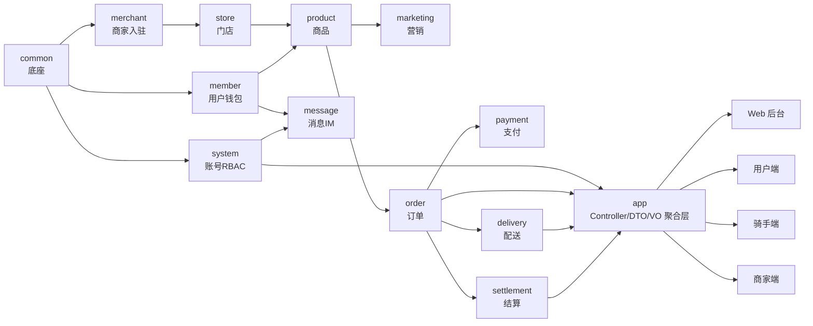

# 数创星光外卖 · SoloEats


本地生活外卖点餐平台。**4 个业务端 + 1 套模块化单体后端**：平台运营后台、商家中心 / 商家端 App、用户端 App、骑手端 App。

后端按业务域拆成 13 个 Maven 模块，共用一套 MySQL / Redis / RabbitMQ / MinIO 中间件，通过 Docker Compose 一键起全栈。

---

## 技术栈

| 层 | 选型 |
|---|---|
| 后端 | Spring Boot 3.5.16 · JDK 17 · MyBatis-Plus 3.5.17 · Redisson 3.52.0 · JJWT 0.12.6 |
| 数据库 | MySQL 8.0 · Flyway 版本化迁移（V1~V22，97 张表） |
| 中间件 | Redis 7.2 · RabbitMQ 3.12 · MinIO（官方镜像已下架，用 Silo 兼容实现） |
| Web 后台 | Vue 3.5 · Vite 6 · TypeScript 5.7 · Element Plus 2.9 · Pinia |
| 三端 App | UniApp（Vue 3）· H5 / 小程序多端编译 |

---

## 架构



**分层约定**：领域模块只放 `domain / mapper / service`；**Controller、DTO、VO 一律放 `solo-eats-app`**，不允许出现反向依赖（如 `product` 不得依赖 `order`）。

---

## 快速开始（Docker 一键）

```bash
# 1. 准备环境变量
cp .env.example .env
#    把所有 change_me_* 占位值改成自己的密码
#    ⚠️ 首次启动前必须把 FLYWAY_ENABLED 改成 true（见下方「三个必踩的坑」）

# 2. 构建并启动
docker compose build app web
docker compose up -d

# 3. 确认全部健康
docker compose ps
```

6 个容器全部 `healthy` 后即可访问 <http://localhost:5173>。

### 三个必踩的坑

**① `FLYWAY_ENABLED` 默认是 `false`**

`docker-compose.yml` 里写的是 `${FLYWAY_ENABLED:-false}`——为了防止对已有库误执行迁移。但**空库首次启动必须手动设为 `true`**，否则表不会建，应用起来后所有接口报错。

**② 旧库无法增量迁移，只能重建**

Flyway 配置是 `baseline-on-migrate=false`。如果库里已经有表、但没有 `flyway_schema_history` 表（比如手工执行过 SQL），Flyway 会直接报错而不是补迁移。这种情况下只能：

```bash
docker compose down
docker volume rm solo-eats_mysql_data   # ⚠️ 会清空数据，先 mysqldump 备份
docker compose up -d
```

**③ MySQL 宿主机端口是 3307，不是 3306**

容器内部仍走 3306（服务名 `mysql`），映射到宿主机是 3307，避免和你本机已装的 MySQL 冲突。

---

## 本地开发

### 后端

```bash
mvn -q -DskipTests package                                    # 全量打包
mvn -q -pl solo-eats-product -am compile                      # 单模块编译
mvn -o -pl solo-eats-app -am -Dtest=CurrentReceiverTest test  # 跑单个测试（需 -am）
```

> 镜像构建阶段不执行测试（Testcontainers 需要 Docker daemon），测试由 `mvn test` 独立执行。

### Web 后台

```bash
cd solo-eats-web
npm install
npm run dev      # 开发服务器，/api 代理到 localhost:8080
npm run build    # 含 vue-tsc --noEmit 类型检查
```

### 三端 App（UniApp H5）

三端**不在 compose 内**，需各自装依赖并单独起。注意 `vite.config.js` 里端口写死 5173，会和 Web 后台撞车，**必须用 `--port` 覆盖**：

```bash
cd solo-eats-uniapp-user     && npm install && npm run dev:h5 -- --port 5174
cd solo-eats-uniapp-rider    && npm install && npm run dev:h5 -- --port 5175
cd solo-eats-uniapp-merchant && npm install && npm run dev:h5 -- --port 5176
```

---

## 访问入口与默认账号

| 端 | 地址 | 说明 |
|---|---|---|
| Web 后台（运营 + 商家中心） | <http://localhost:5173> | nginx 静态托管，`/api` 反代到 app |
| 用户端 App H5 | <http://localhost:5174> | 需先起 dev server |
| 骑手端 App H5 | <http://localhost:5175> | 需先起 dev server |
| 商家端 App H5 | <http://localhost:5176> | 需先起 dev server |
| 后端 API | <http://localhost:8080> | `/healthz` `/readyz` 健康检查 |
| MinIO 控制台 | <http://localhost:9001> | 账号见 `.env` |
| RabbitMQ 控制台 | <http://localhost:15672> | 账号见 `.env` |

**默认账号**（来自种子数据 `V4__system_rbac.sql`）：

| 账号 | 密码 | 角色 |
|---|---|---|
| `admin` | `Admin@123` | 平台超管 |
| `merchant1` | `Merchant@123` | 商家管理员（merchantId=1, shopId=1） |
| `rider1` | `Rider@123` | 骑手（`rider001` 是同一骑手别名，两者都可用） |

**用户端登录**：手机号 + 验证码，验证码固定 `000000`（`AUTH_MOCK_SMS_ENABLED=true`），用户不存在时自动注册。注意请求字段名是 `code` 而不是 `smsCode`。

**模拟登录**（`AUTH_MOCK_LOGIN_ENABLED=true` 时可用）：`{"role":"ADMIN"}`、`{"role":"MERCHANT","merchantId":1,"shopId":1}`、`{"role":"RIDER","riderId":1}`，不校验密码直接签发 JWT。

> 演示门店坐标 **lng=116.470 / lat=39.990**（望京SOHO T1）。`GET /api/v1/c/shops` 的 `lng`/`lat` 是必填参数，缺参数会返回「系统异常」，容易误判为后端故障。

---

## 目录结构

```
solo-eats/
├── solo-eats-common/        公共底座：ApiResponse、JWT、幂等、限流、分布式锁、DataScope
├── solo-eats-system/        账号、RBAC、租户、组织、字典、日志、邮件、公告
├── solo-eats-member/        用户、收货地址、钱包、标签分群
├── solo-eats-merchant/      商家入驻、资质审核、PII 加密
├── solo-eats-store/         门店、营业时间、配送围栏
├── solo-eats-product/       品类、SPU、门店商品、规格加料、估清、评价
├── solo-eats-marketing/     优惠券、满减活动
├── solo-eats-order/         订单、状态机、退款、明细快照
├── solo-eats-payment/       支付单、Mock 网关、回调验签
├── solo-eats-delivery/      骑手认证、调度派单、轨迹、运费、骑手收入
├── solo-eats-settlement/    结算单、抽佣、提现打款
├── solo-eats-message/       站内信、WebSocket、IM 会话
├── solo-eats-app/           聚合层：61 个 Controller + DTO/VO + Flyway 迁移脚本
├── solo-eats-web/           Web 后台（Vue3 + Vite + Element Plus）
├── solo-eats-uniapp-user/   用户端 App（11 页）
├── solo-eats-uniapp-rider/  骑手端 App（8 页）
├── solo-eats-uniapp-merchant/ 商家端 App（8 页）
├── docs/                    需求、架构、验收、任务卡
├── scripts/                 冒烟测试与工具脚本
└── docker-compose.yml       全栈编排
```

---

## 测试与脚本

CI 在 `.github/workflows/ci.yml`：`mvn -B -Pisolated-build clean test` → 单独构建镜像。有一条硬性规则——**任何 `Skipped` 测试都会阻断构建**（防止 Testcontainers 不可用时静默跳过）。

本地冒烟脚本（需要服务已启动）：

| 脚本 | 覆盖内容 |
|---|---|
| `scripts/container-smoke-test.py` | 容器化全链路：登录→下单→支付→回调→MQ 消费确认库存 |
| `scripts/refund-smoke-test.sh` | 售后退款与逆向履约 |
| `scripts/settlement-smoke-test.sh` | 结算与对账 |
| `scripts/security-smoke-test.sh` | 鉴权与安全边界 |
| `scripts/ws-smoke-test.mjs` | WebSocket 握手、心跳、订单状态推送 |
| `scripts/run-claude-task.sh` | 把单张任务卡派发给 Claude Code 无头执行 |

---

## 项目完成度

当前处于 **P0 主干可跑通、P1 未启动** 阶段：17 张任务卡约 24 个会话单元已交付，仍有 2 处 P0 缺口未完成。逐卡明细与复核方法见 **[docs/PROGRESS.md](docs/PROGRESS.md)**。

---

## 文档索引

| 文档 | 内容 |
|---|---|
| [`CLAUDE.md`](CLAUDE.md) | 项目约定、编码红线——**动手前必读** |
| [`docs/全栈启动与体验指南.md`](docs/全栈启动与体验指南.md) | 启动步骤、各端体验路径、接口清单 |
| [`docs/本地开发环境搭建指南.md`](docs/本地开发环境搭建指南.md) | 环境依赖与中间件配置 |
| [`docs/外卖需求规格说明书.md`](docs/外卖需求规格说明书.md) | 需求正本 |
| [`docs/技术架构与数据库设计说明书.md`](docs/技术架构与数据库设计说明书.md) | 架构与表设计 |
| [`docs/PROGRESS.md`](docs/PROGRESS.md) | **项目完成度**：逐卡已交付/未交付明细与复核方法 |
| [`docs/tasks/`](docs/tasks/) | 17 张任务卡的派发与执行记录（进度正本） |
| `docs/*验收.md` | 订单、支付、履约、售后、结算、API 安全、自动化部署 7 份验收文档 |

> ⚠️ `docs/全栈启动与体验指南.md` 与 `docs/本地开发环境搭建指南.md` 的部分数字停留在较早版本（如「22 张表」「6e309da 基线」），以本 README 和实际代码为准。

---

## 已知限制

- **支付走 Mock 通道**，未接支付宝沙箱；`PaymentGateway` 抽象已预留扩展位。
- **短信通道未接**，验证码固定 `000000`；邮件功能需自行配置 SMTP，全部留空时不影响其他模块启动。
- **商家 PII（法人身份证 / 银行卡）依赖 `PII_KEY`**，该值为空时商家入驻写入会直接报错。
- **图片存储用 MinIO 的 Silo 兼容镜像**，因为 MinIO 官方镜像已下架。
