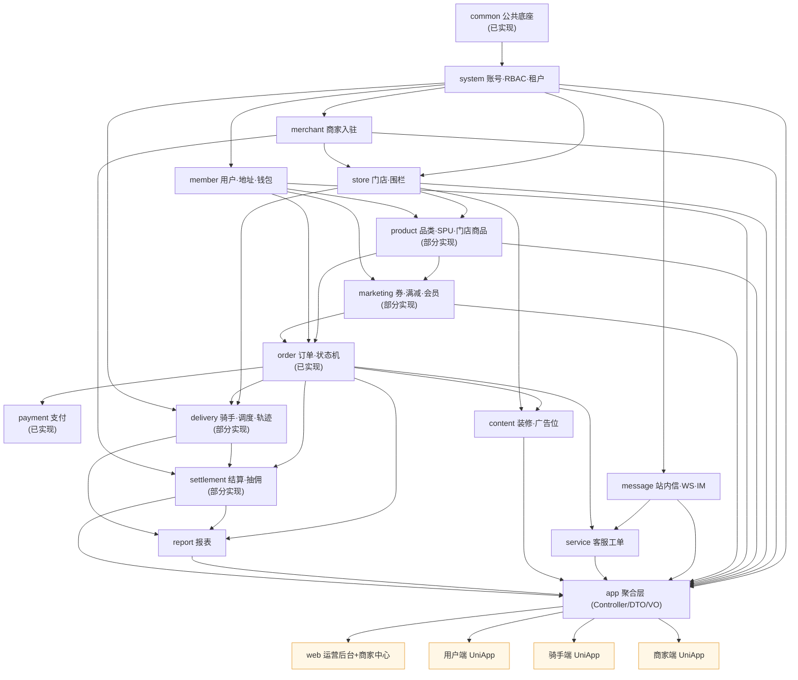

# SoloEats 增量开发任务板（Task Board）

> 版本：v1.0 · 基线提交：`master@6e309da`  
> 依据：《外卖需求规格说明书》(138KB)、《技术架构与数据库设计说明书》(74KB)、《全栈启动与体验指南》  
> 用途：把 171 个已有 Java 文件、8 个 Maven 模块的现状，与规格书 10 个业务功能域之间的差距，拆成**可在 Claude Code 单会话内执行**的任务卡。

---

## 0. 怎么用这个任务板

1. 每次只领**一个任务卡的一个阶段**（`T01 阶段A`）。任务卡内标注「阶段 A/B/C」的，表示该卡文件数超过 20，必须拆成多次会话。
2. 开始前先 `Read` 对应任务卡全文，再 `Read` 卡里「前置依赖」列出的类。
3. 完成后必须：本模块编译通过 → 全量打包不回归 → 回写任务卡末尾「执行记录」。
4. 卡与卡之间的「禁止事项」不可协商，尤其**不得改动 `OrderStateMachine`、`ApiResponse`、`PageResult`、`ErrorCode` 已有码值**。

---

## 1. 模块拆解矩阵（后端）

> 注：本表「序号」是**模块**编号，与下方**任务编号 T01~T17** 不是同一套编号，请勿混用。

| 序号 | Maven 模块               | 规格书章节         | 现状                                                                                               | 优先级                  | 任务编号           |
| -- | ---------------------- | ------------- | ------------------------------------------------------------------------------------------------ | -------------------- | -------------- |
| 1  | `solo-eats-common`     | 2.3 / 9.6     | **已实现**：ApiResponse/PageResult/JWT/@RequireRole/BizException/幂等/分布式锁/限流/TraceId/Rabbit 常量/支付网关抽象 | 底座                   | T01、T03 增量改造   |
| 2  | `solo-eats-system`     | 3 / 4.12      | **缺失**（当前无任何账号表，登录是 `@Profile("local")` mock）                                                    | P0                   | T01、T02        |
| 3  | `solo-eats-merchant`   | 4.2           | **缺失**                                                                                           | P0                   | T03            |
| 4  | `solo-eats-store`      | 4.2           | **缺失**                                                                                           | P0                   | T04            |
| 5  | `solo-eats-product`    | 4.3           | **部分**：仅 `t_sku` + `t_sku_stock` + 锁定/流水（21 文件）。缺品类、商品库(SPU)、门店商品、规格组、加料、估清、评价                   | P0                   | T05            |
| 6  | `solo-eats-order`      | 4.4 / 8.1~8.9 | **已实现**：订单/明细/优惠快照/状态机/退款/查询/MQ（43 文件）                                                           | —                    | 无（P1 售后仲裁可另开卡） |
| 7  | `solo-eats-payment`    | 4.8           | **已实现**：支付单 + Mock 网关 + 回调验签（13 文件）                                                              | —                    | 无（P1 对账、支付宝沙箱接入可另开卡）   |
| 8  | `solo-eats-delivery`   | 4.5 / 8.3     | **部分**：配送单 + 骑手收入（8 文件）。缺骑手管理、认证、调度策略、轨迹、运费模板、围栏                                                 | P0                   | T07            |
| 9  | `solo-eats-settlement` | 4.8 / 8.4     | **部分**：结算单/明细/账单视图（16 文件）。缺抽佣规则引擎、提现审核、资金流水                                                      | P1                   | T16（补充）        |
| 10 | `solo-eats-marketing`  | 4.6           | **部分**：券模板 + 用户券（8 文件）。缺满减、折扣、秒杀、红包、签到、邀请、会员、积分                                                  | P1                   | T12            |
| 11 | `solo-eats-member`     | 4.7 / 5.2.9   | **缺失**                                                                                           | P0                   | T06            |
| 12 | `solo-eats-message`    | 4.9 / 5.2.7   | **缺失**（Rabbit 常量已在 common，WebSocket 未落地）                                                         | P0（站内信+订单节点）/ P1（IM） | T08            |
| 13 | `solo-eats-service`    | 4.10          | **缺失**                                                                                           | P1                   | T09            |
| 14 | `solo-eats-content`    | 4.9           | **缺失**                                                                                           | P1                   | T10            |
| 15 | `solo-eats-report`     | 4.11          | **缺失**                                                                                           | P1                   | T11            |
| 16 | `solo-eats-app`        | 2.1           | **部分**：8 个 Controller。所有新增端点的落点                                                                  | 贯穿                   | 每张卡都会改         |

**前端**

| 序号 | 工程                           | 规格书章节      | 现状                                                                                                                | 优先级 | 任务编号    |
| -- | ---------------------------- | ---------- | ----------------------------------------------------------------------------------------------------------------- | --- | ------- |
| 17 | `solo-eats-web`（运营后台 + 商家中心） | 4.0 / 4.13 | **部分**：6 个业务页（Login / AdminOverview / AdminSettlements / MerchantOrders / MerchantProducts / MerchantSettlements） | P1  | T17（补充） |
| 18 | 用户端 UniApp（49 页）             | 5          | **缺失**                                                                                                            | P0  | T13     |
| 19 | 骑手端 UniApp（24 页）             | 6          | **缺失**                                                                                                            | P0  | T14     |
| 20 | 商家端 UniApp（9 页）              | 7          | **缺失**                                                                                                            | P0  | T15     |

---

## 2. 模块依赖图

> 红线：**不允许出现反向依赖**。`product` 不得依赖 `order`；`marketing` 不得依赖 `order`；`delivery` 不得依赖 `order`（`order → delivery` 是既有方向，只能由 `order` 调 `DeliveryService` 接口）。

---

## 3. 任务总表

| 编号      | 标题                                              | 所属模块                                    | 优先级   | 依赖任务        | 预估文件数          | 一句话交付物                                           |
| ------- | ----------------------------------------------- | --------------------------------------- | ----- | ----------- | -------------- | ------------------------------------------------ |
| **T01** | system-RBAC（账号/角色/菜单 + 登录鉴权落地）                  | `solo-eats-system` + `app` + `common`   | P0    | —           | 35（分 A/B/C 三段） | 真实账号密码登录 + `@RequirePermission` + 菜单树，替换 mock 用户 |
| **T02** | system-租户·组织·日志（租户/套餐/部门/岗位/字典/操作日志/登录日志/邮件/公告） | `solo-eats-system`                      | P0    | T01         | 34（分 A/B 两段）   | 多租户隔离落地 + 后台审计日志可查                               |
| **T03** | merchant-入驻审核 + MinIO 文件存储                      | `solo-eats-merchant` + `common` + `app` | P0    | T01         | 24（分 A/B 两段）   | 文件上传可用 + 商家入驻→审核→生成管理员账号闭环                       |
| **T04** | store-门店（CRUD/营业状态/配送围栏/门店账号）                   | `solo-eats-store` + `app`               | P0    | T01、T03     | 22             | 门店可建可停业、围栏可校验、门店账号可登录                            |
| **T05** | product-品类·商品库·门店商品·规格加料·估清·评价                  | `solo-eats-product` + `app`             | P0    | T04         | 30（分 A/B 两段）   | 用户端能按门店菜单点单（含规格/加料/估清），评价可写可回                    |
| **T06** | member-用户·收货地址·钱包账单                             | `solo-eats-member` + `app`              | P0    | T01         | 20             | 手机号验证码登录（C 端）+ 地址簿 + 钱包流水                        |
| **T07** | delivery-骑手·调度派单·轨迹·运费围栏                        | `solo-eats-delivery` + `app`            | P0    | T04、T05     | 26（分 A/B 两段）   | 骑手认证→上线→抢单→取货→送达全链路 + 轨迹上报                       |
| **T08** | message-站内信·WebSocket·IM 会话                     | `solo-eats-message` + `app`             | P0/P1 | T01、T06     | 18（分 A/B 两段）   | 订单节点实时推送 + 三端共用会话通道                              |
| **T09** | service-客服工单·投诉·FAQ                             | `solo-eats-service` + `app`             | P1    | T08         | 14             | 工单状态机落地 + 用户提交/客服处理闭环                            |
| **T10** | content-首页装修·广告位·搜索运营·版本管理                      | `solo-eats-content` + `app`             | P1    | T04、T05     | 16             | 首页配置化下发（Banner/金刚区/楼层）                           |
| **T11** | report-经营/流量/商品/财务报表                            | `solo-eats-report` + `app`              | P0（阶段A 工作台+经营总览）/ P1 | T05、T07、T16 | 14（分 A/B 两段） | 日粒度预聚合表 + 工作台今日卡 + 5 张核心报表接口              |
| **T12** | marketing-满减·秒杀·会员·积分·签到                        | `solo-eats-marketing` + `app`           | P0（阶段A-0 单档满减）/ P1 | T05、T06     | 28（分 A-0/A/B 三段） | 满减可叠加、秒杀不超卖、会员等级可升降                              |
| **T13** | 用户端 UniApp（49 页，P0 13 页）                        | 新建 `solo-eats-uniapp-user`              | P0/P1 | T05、T06、T07、T08 | 20（分 A/B）      | 首页→店铺→购物车→下单→支付→订单/取餐码→评价 可跑通                       |
| **T14** | 骑手端 UniApp（24 页，P0 8 页）                         | 新建 `solo-eats-uniapp-rider`             | P0/P1 | T07         | 16（分 A/B）      | 听单→抢单→取货→送达→收入 可跑通                               |
| **T15** | 商家端 UniApp（9 页，P0 7 页）                          | 新建 `solo-eats-uniapp-merchant`          | P0/P1 | T04、T05     | 12（分 A/B）      | 接单/拒单→出餐→自取核销→门店设置 可跑通                                |
| **T16** | settlement-抽佣规则·提现审核·资金流水（补充）                   | `solo-eats-settlement` + `app`          | P0（阶段A 结算打款+提现）/ P1 | T03、T07     | 16（分 A/B 两段） | 三级抽佣（活动>商家>品类>全局）+ 提现单状态流转                       |
| **T17** | web-运营后台与商家中心页面（补充）                             | `solo-eats-web`                         | P0（批次0 配置界面）/ P1 | T01~T07、T11、T16 | 18/批           | 每个已交付后端模块配套 1~2 个列表+表单页                          |

**合计：17 张任务卡，约 34 个可执行会话单元（阶段）。其中后端 P0 底座 16 个会话单元（T01×3 + T02×2 + T03×2 + T04×1 + T05×2 + T06×1 + T07×2 + T08-A×1 + T16-A×1），另有 P0 先行段 T11-A、T12-A-0、T17 批次0。**

---

## 4. 推荐执行顺序（分批次，每批一串独立可编译的会话）

> 每批次结束时系统必须 `mvn -q -DskipTests package` 全绿，且既有 demo 链路（下单→支付→出餐→自提核销→结算）不回归。

### 批次 1：账号与地基（必须先做，否则其余卡都没有"谁在操作"）

| 顺序 | 会话单元                      | 产出                                                                                             |
| -- | ------------------------- | ---------------------------------------------------------------------------------------------- |
| 1  | **T01 阶段A** ← **推荐第一个执行** | `solo-eats-system` 模块骨架 + `V4__system_rbac.sql` 五表 + 账号密码登录打通（`POST /api/v1/auth/login` 兼容旧契约） |
| 2  | T01 阶段B                   | 用户/角色/菜单 CRUD + 分配角色/授权菜单                                                                      |
| 3  | T01 阶段C                   | `@RequirePermission` 注解 + 拦截器 + Redis 权限缓存 + `PermissionGuard` 增强                              |
| 4  | T02 阶段A                   | 租户/套餐/部门/岗位/字典（5 表）                                                                            |
| 5  | T02 阶段B                   | 操作日志/登录日志/邮件/公告（5 表 + AOP 切面）                                                                  |

### 批次 2：招商与门店（商家能建店，商品才有归属）

| 顺序 | 会话单元                                 |
| -- | ------------------------------------ |
| 6  | T03 阶段A：MinIO 文件服务 + `/api/v1/files` |
| 7  | T03 阶段B：入驻申请/资质/审核流转/结算账户            |
| 8  | T04：门店 CRUD + 营业状态 + 围栏校验 + 门店账号     |

### 批次 3：商品与用户（下单前的最后一公里）

| 顺序 | 会话单元                                          |
| -- | --------------------------------------------- |
| 9  | T05 阶段A：品类树 + SPU 商品库 + 门店商品上下架（兼容既有 `t_sku`） |
| 10 | T05 阶段B：规格组/加料/估清 + 商品评价                      |
| 11 | T06：C 端验证码登录 + 用户资料 + 地址簿 + 钱包                |

### 批次 4：履约（配送 + 消息 + P0 结算打款）

| 顺序 | 会话单元                                    |
| -- | --------------------------------------- |
| 12 | T07 阶段A：骑手档案/认证 + 上线/听单/抢单              |
| 13 | T07 阶段B：取货/送达/轨迹 + 运费模板/围栏 + 派单策略配置     |
| 14 | T08 阶段A：WebSocket 通道 + 站内信 + 订单节点推送（P0） |
| 15 | **T16 阶段A（P0）**：结算单审核→模拟打款 + 提现最小闭环（对应 1.6「结算单模拟打款」） |
| 16 | **T12 阶段A-0（P0）**：平台级单档满减 + 试算/分摊（供下单链路，须在 order 联调前完成） |
| 17 | **T11 阶段A（P0）**：工作台今日卡 + 经营总览日粒度 |
| 18 | T08 阶段B：IM 会话（P1）                       |

### 批次 5：三端前端（可并行）

| 顺序 | 会话单元                               |
| -- | ---------------------------------- |
| 19 | T13 阶段A / T14 阶段A / T15 阶段A（可三线并行） |
| 20 | **T17 批次0（P0）**：商家审核/门店/商品/基础券/工作台的最小配置界面（随 P0 后端卡交付） |
| 21 | T13 阶段B / T14 阶段B / T15 阶段B        |

### 批次 6：运营增值（P1）

T16 阶段B → T09 → T10 → T12 阶段A/B → T11 阶段B → T17 批次1~4

---

## 5. 执行约定（每个会话单元都必须满足）

| 项    | 要求                                                                                                                                      |
| ---- | --------------------------------------------------------------------------------------------------------------------------------------- |
| 增量编译 | `mvn -q -pl solo-eats-<module> -am compile` 必须 0 error                                                                                  |
| 全量回归 | `mvn -q -DskipTests package` 必须 BUILD SUCCESS（不得因新增模块破坏 parent 聚合）                                                                      |
| 前端构建 | 涉及 `solo-eats-web` 时 `cd solo-eats-web && npm run build` 必须通过（含 `vue-tsc --noEmit`）                                                     |
| 数据库  | 新增表一律用 Flyway `V<下一个序号>__<描述>.sql`，放 `solo-eats-app/src/main/resources/db/migration/`；当前最大序号 `V3`，新迁移从 `V4` 起。**只增不改**（Expand-Contract） |
| 测试   | 新增核心 service 至少 1 个 `@ExtendWith(MockitoExtension.class)` 单测；**不得删除或修改既有测试**                                                            |
| 契约   | 不得修改 `ApiResponse` / `PageResult` / `ErrorCode` 已有码值 / `OrderStateMachine` / 既有接口路径与字段                                                  |
| 回写   | 完成后在任务卡「执行记录」追加：日期、会话范围、新增/修改文件数、编译结果、遗留问题                                                                                              |
| 提交   | 一个会话单元一个 commit，信息格式 `feat(T01-A): 账号密码登录落地`                                                                                            |

---

## 6. 全局共享知识（Shared Knowledge）

| 主题    | 约定                                                                                                                                                        |
| ----- | --------------------------------------------------------------------------------------------------------------------------------------------------------- |
| 响应结构  | 一律 `ApiResponse<T>{code,message,data,traceId}`，`code=0` 成功；异常抛 `BizException(ErrorCode)`                                                                  |
| 分页    | 一律 `PageResult<T>{list,total,pageNum,pageSize}`，`pageNum` 从 1 开始，`pageSize` 默认 20、上限 100                                                                  |
| 金额    | 一律 `bigint` 存**分**，Java 用 `long`；费率用 `BigDecimal` / `decimal(6,4)`；禁止 `double`                                                                            |
| 主键    | `bigint unsigned` 自增，实体 `@TableId(type = IdType.AUTO)`                                                                                                    |
| 审计字段  | `created_at datetime(3) DEFAULT CURRENT_TIMESTAMP(3)`、`updated_at datetime(3) ... ON UPDATE`、`deleted tinyint DEFAULT 0`、`version int unsigned DEFAULT 0` |
| 命名    | 表 `t_`；字段 `snake_case`；索引 `idx_`；唯一键 `uk_`；Java 驼峰，MyBatis-Plus 自动映射                                                                                      |
| 租户    | 新增表必带 `tenant_id bigint unsigned NOT NULL DEFAULT 1`；由 `TenantContext`（T02 落地）自动填充，业务代码不手写                                                                |
| ID 生成 | 不引入雪花；订单号等业务单号沿用现有生成器                                                                                                                                     |
| 时间    | 统一 `Asia/Shanghai`；`application.yml` 已配置 Jackson `yyyy-MM-dd HH:mm:ss`                                                                                    |
| 角色码   | 复用 `Roles.C_USER/MERCHANT/RIDER/ADMIN`，不得新增角色常量字符串散落各处                                                                                                    |
| 状态更新  | 必须条件更新 `WHERE id=? AND status=?`，关键表带 `version`                                                                                                           |
| 幂等    | 写接口加 `@Idempotent(bizType=...)`；下单/支付/退款/核销必带 `Idempotency-Key`                                                                                           |
| 逻辑删除  | 仅配置类表（商家/门店/商品/营销/内容/系统）用 `deleted`；订单、支付、退款、结算**不做**逻辑删除                                                                                                 |
| 敏感信息  | 手机号/身份证/银行卡入库前加密（`AES`，密钥走环境变量），接口返回脱敏（`138****8000`）                                                                                                     |
| 目录约定  | 领域模块只放 `domain/mapper/service`；**Controller/DTO/VO 一律放 `solo-eats-app`**（沿用现状）                                                                            |
| 错误码分段 | 1xxxx 系统、2xxxx 订单、3xxxx 资金/支付、4xxxx 库存/营销、5xxxx 配送、6xxxx 结算、7xxxx 商家/门店、8xxxx 用户/会员、9xxxx 消息/内容/客服、10xxxx 报表 |

---

## 7. 待澄清（阻塞项，需产品经理确认）

| #  | 问题                                                                                                                                                  | 影响任务        |
| -- | --------------------------------------------------------------------------------------------------------------------------------------------------- | ----------- |
| Q1 | 规格书 9.6 写 `{code,message,data,traceId}`，而"多租户"要求所有业务表带 `tenant_id`；**既有 21 张表**（订单/库存/券/支付/结算）是否补 `tenant_id`？建议 **不补**，用 `merchant_id/shop_id` 做隔离 | T02         |
| Q2 | 既有 `t_sku` 已含 `shop_id + spu_id`，等价于"门店 SKU"。是否同意**保留 `t_sku` 作为门店 SKU 表**，另建 `t_spu` 商品库，而不是重构 `t_sku`？                                            | T05         |
| Q3 | 规格书 1.6 把"基础券"放 P0、"满减"放 P1，但 9.8 优惠叠加规则要求满减参与分摊。P0 是否允许**满减只做平台级单档**？                                                                              | T12         |
| Q4 | 商家端 App 与商家中心 Web"共用账号"，但当前 token 里 `shopId` 是单值。多门店切换是**换 token** 还是 **token 带 shopIds 列表 + 请求头 X-Shop-Id**？建议后者，需确认                               | T04、T15     |
| Q5 | 三个 UniApp 工程是**建在本仓库子目录**还是独立仓库？建议本仓库 `solo-eats-uniapp-{user,rider,merchant}`，便于 Claude Code 一次读取后端 DTO                                            | T13/T14/T15 |
| Q6 | ~~支付 Mock 偏差~~ **已定方案**：P0 用 Mock 通道打通全链路（`channel=mock`），支付宝沙箱作为 **P1 增强**——在 `PaymentGateway` 抽象下新增 `AlipaySandboxGateway`（独立补充卡，不改 `PaymentService.pay` 契约与 Mock 实现）。前端 `channel` 由后端「可用支付渠道」接口下发，不写死。**仍需产品确认**：P0 验收口径是否接受「Mock 打通 + 沙箱代码就绪但未开通个人沙箱」 | T13、order/payment |
| Q7 | ~~商家中心独立工程~~ **已定方案**：采用「**同仓双入口**」——保留 `solo-eats-web` 作运营后台，新建 `solo-eats-web-merchant/`（独立 package.json/vite/build/dist，独立部署域名 `/merchant/`），共享层抽 `shared/`（http/money/auth/constants）。满足 13 章「独立构建/部署/访问」，见 T17「商家中心独立工程」一节 | T17 |

## 8. 已决事项（第三、四批修复后登记，避免功能真空）

| 编号 | 事项 | 归属/决策 | 落点 |
| -- | ------------------------------------------------------------------- | ---------------------------------------- | ---------------- |
| D-1 | 8.7 准时达链路 | 承诺送达时间 `promise_deliver_at`（Expand 增列）+ 超时判定定时任务归 **T07**；准时率归 **T11**；超时罚款归 **T16**（聚合 `t_rider_income`，不重复判定） | T07/T11/T16 |
| D-2 | 客服工作台坐席端（会话列表/接待/转接/结束/快捷话术/会话记录） | 归 **T09**（复用 T08 `ImService` + `peer_type=4`），接口 21~26 | T09 |
| D-3 | 隐私协议确认记录（5.2.1/9.11.0 撤回同意） | 归 **T06**（`t_member_agreement_confirm` 表 + 接口 21/22） | T06 |
| D-4 | 用户标签分群（4.7） | 归 **T06**（`t_member_tag` + `t_member_tag_rel`，手动打标，自动打标 TODO） | T06 |
| D-5 | 后台地址管理/导出/异常标记 + 用户拉黑状态 | 归 **T06**（接口 25/26；`status` 扩 `2拉黑` 供 T09 联动） | T06 |
| D-6 | 素材库（4.3） | 归 **T05**（`t_media_group` + `t_media_item`，复用 T03 文件服务），接口 24/25 | T05 |
| D-7 | 连锁/品牌管理（4.2） | **本期裁剪**（P1/P2），`t_shop.brand_id` 仅预留，验收不覆盖 | T04 |
| D-8 | 推送设置（5.2.7 用户开关通知） | 归 **T08**（`t_notify_setting` 表 + 接口 15/16） | T08 |
| D-9 | 错误码分段全局重排 | 见「全局共享知识」：`8xxxx` 改「用户/会员」（T06），`9xxxx` 改「消息/内容/客服」（T08/T09/T10），新增 `10xxxx 报表`（T11） | README + T06/T08/T09/T10/T11 |
| C-2 | RBAC data_scope 行级权限 | 归 **T02 阶段C**（`DataScopeInnerInterceptor`）；T01 阶段C 补 `UserPrincipal.merchantId/shopId/userId` | T01/T02 |
