# 「数创星光外卖」本地生活外卖点餐平台

*需求规格说明书（SRS）*

| 项目 | 内容 |
| --- | --- |
| 文档名称 | 需求规格说明书 |
| 版本号 | V1.0 |
| 编制日期 | 2026-10-12 |
| 文档状态 | 完成第一版 |
| 参考系统 | 开源项目 yshop-drink（仅作技术栈与实现经验参考，不作为后台功能蓝本） |
| 文档用途 | ① 团队内部练习作业命题；② UI 视觉稿与交互原型交付 |
| 读者对象 | 产品、研发、测试、实施、练习作业参与者 |

**说明**

本文档为面向甲方评审的完整需求文档，用于确认建设范围、系统构成、功能清单与交付边界，不作为开发代码生成的输入。

**落地约束**：凡**个人资质无法申请、且无替代方案**的能力（微信支付商户号、短信、企业级推送、云打印硬件、第三方运力、人脸实名、电子发票、认证公众号等）一律**取消或改为等价替换实现**；凡有**官方沙箱 /免费额度 / 可自建**的能力（支付宝沙箱、地图个人 Key、MinIO、自建 IM 等）**全部保留**。详见 `1.5`。

**原型图说明**：文档中的 UI 图均为**按本文档内容设计的高保真视觉稿**（视觉基调为**方正小圆角 + 紧凑黑体+ 细描边线性图标**，四端差异化主题，含柔和阴影与渐变质感），用于确认信息层级、视觉风格与组件规范。图中的商品图 / 店铺头图使用渐变占位，文案与数据均为演示数据。

**先看总览**：如需快速掌握"要做几个系统、多少个页面、哪些功能、用什么技术"，可直接阅读 `1.7` 交付总览。

## 目录

- [1. 项目概述](#1-项目概述)
  - [1.1 项目背景](#11-项目背景)
  - [1.2 建设目标](#12-建设目标)
  - [1.3 参考系统定位](#13-参考系统定位)
  - [1.4 系统边界与范围](#14-系统边界与范围)
  - [1.5 个人开发者可行性与功能取舍](#15-个人开发者可行性与功能取舍)
  - [1.6 需求优先级与 MVP 范围](#16-需求优先级与-mvp-范围)
  - [1.7 交付总览（系统 / 页面 / 功能 / 技术栈）](#17-交付总览系统--页面--功能--技术栈)
- [2. 系统总体架构与系统构成](#2-系统总体架构与系统构成)
  - [2.1 系统构成（共 6 个系统）](#21-系统构成共-6-个系统)
  - [2.2 总体架构图](#22-总体架构图)
  - [2.3 后端模块划分（按新业务域重新规划）](#23-后端模块划分按新业务域重新规划)
  - [2.4 第三方对接清单（含个人可用性评估）](#24-第三方对接清单含个人可用性评估)
  - [2.5 核心领域模型（实体清单）](#25-核心领域模型实体清单)
- [3. 用户角色与权限模型](#3-用户角色与权限模型)
  - [3.1 角色清单](#31-角色清单)
  - [3.2 权限模型](#32-权限模型)
  - [3.3 角色—权限矩阵（摘要）](#33-角色—权限矩阵摘要)
- [4. 平台运营后台需求（全新设计）](#4-平台运营后台需求全新设计)
  - [4.0 后台导航结构（总览）](#40-后台导航结构总览)
  - [4.1 工作台与数据看板](#41-工作台与数据看板)
  - [4.2 商家招商](#42-商家招商)
  - [4.3 商品中心](#43-商品中心)
  - [4.4 订单中心](#44-订单中心)
  - [4.5 配送中心（核心新增）](#45-配送中心核心新增)
  - [4.6 营销中心](#46-营销中心)
  - [4.7 用户中心](#47-用户中心)
  - [4.8 资金中心](#48-资金中心)
  - [4.9 内容运营](#49-内容运营)
  - [4.10 客服与工单](#410-客服与工单)
  - [4.11 数据报表](#411-数据报表)
  - [4.12 系统管理与基础设施](#412-系统管理与基础设施)
  - [4.13 商家中心导航结构（独立工程）](#413-商家中心导航结构独立工程)
- [5. 用户端外卖 App 需求（全新设计）](#5-用户端外卖-app-需求全新设计)
  - [5.1 信息架构（底部 Tab）](#51-信息架构底部-tab)
  - [5.2 功能模块明细](#52-功能模块明细)
  - [5.3 用户端关键页面原型图（高保真视觉稿）](#53-用户端关键页面原型图高保真视觉稿)
  - [5.4 视觉与交互设计规范（统一设计令牌）](#54-视觉与交互设计规范统一设计令牌)
- [6. 骑手端 App 需求（全新设计）](#6-骑手端-app-需求全新设计)
  - [6.1 信息架构](#61-信息架构)
  - [6.2 功能明细](#62-功能明细)
  - [6.3 骑手端关键页面原型图（高保真视觉稿）](#63-骑手端关键页面原型图高保真视觉稿)
- [7. 商家端 App 需求（全新设计）](#7-商家端-app-需求全新设计)
  - [7.1 功能明细](#71-功能明细)
  - [7.2 商家端关键页面原型图](#72-商家端关键页面原型图)
- [8. 关键业务流程与规则](#8-关键业务流程与规则)
  - [8.1 外卖下单 — 配送 — 完成（主流程）](#81-外卖下单-—-配送-—-完成主流程)
  - [8.2 退款/售后流程](#82-退款售后流程)
  - [8.3 派单流程](#83-派单流程)
  - [8.4 结算流程](#84-结算流程)
  - [8.5 消息触达流程](#85-消息触达流程)
  - [8.6 到店自取流程](#86-到店自取流程)
  - [8.7 超时与准时达规则](#87-超时与准时达规则)
  - [8.8 售后期与结算冻结规则](#88-售后期与结算冻结规则)
  - [8.9 状态机全集](#89-状态机全集)
- [9. 设计约定与非功能需求](#9-设计约定与非功能需求)
  - [9.1 性能](#91-性能)
  - [9.2 可用性与可靠性](#92-可用性与可靠性)
  - [9.3 安全](#93-安全)
  - [9.4 兼容性](#94-兼容性)
  - [9.5 可维护性](#95-可维护性)
  - [9.6 接口设计约定](#96-接口设计约定)
  - [9.7 金额与精度规范](#97-金额与精度规范)
  - [9.8 优惠叠加与分摊规则](#98-优惠叠加与分摊规则)
  - [9.9 数据字典与枚举（摘要）](#99-数据字典与枚举摘要)
  - [9.10 埋点方案（支撑流量与转化分析）](#910-埋点方案支撑流量与转化分析)
  - [9.11 合规与个人信息保护](#911-合规与个人信息保护)
- [10. 实施计划与里程碑](#10-实施计划与里程碑)
- [11. 测试方案](#11-测试方案)
  - [11.1 测试层级](#111-测试层级)
  - [11.2 关键测试用例（摘要）](#112-关键测试用例摘要)
  - [11.3 缺陷分级与准出](#113-缺陷分级与准出)
- [12. 上线与运维方案](#12-上线与运维方案)
  - [12.1 环境划分](#121-环境划分)
  - [12.2 部署与发布](#122-部署与发布)
  - [12.3 上线 checklist](#123-上线-checklist)
  - [12.4 回滚与应急](#124-回滚与应急)
  - [12.5 运维](#125-运维)
- [13. 验收标准](#13-验收标准)
- [14. 附录](#14-附录)
  - [14.1 页面清单（用户端）](#141-页面清单用户端)
  - [14.2 页面清单（骑手端）](#142-页面清单骑手端)
  - [14.3 页面清单（商家端 / 商家中心）](#143-页面清单商家端--商家中心)
  - [14.4 页面清单（平台运营后台）核心页面](#144-页面清单平台运营后台核心页面)
  - [14.5 术语表](#145-术语表)
  - [14.6 甲方确认记录](#146-甲方确认记录)
  - [14.7 风险登记册](#147-风险登记册)
  - [14.8 个人开发环境清单（练习者参考）](#148-个人开发环境清单练习者参考)

## 1. 项目概述

### 1.1 项目背景

面向本地生活服务市场，需要建设一套**覆盖"用户下单 — 商家出餐 — 骑手配送 — 平台运营"全链路的外卖点餐平台**。

本项目**从零设计**四端（平台运营后台、用户端 App、骑手端 App、商家端 App），参考美团外卖的业务形态与交互设计。开源项目 `yshop-drink` 仅作为**技术栈选型与实现经验的参考**（Java 17 / Spring Boot 3 / Vue 3 / UniApp 已有成熟实践），**其后台模块划分不作为本项目的功能蓝本**。

### 1.2 建设目标

| 目标 | 说明 |
| --- | --- |
| 业务闭环 | 用户下单 → 商家接单出餐 → 平台派单 → 骑手配送 →用户收货评价 → 平台结算，全流程线上化 |
| 多端协同 | 用户端、骑手端、商家端、运营后台四端数据实时一致，状态可追溯 |
| 双履约 | 支持平台配送（外卖到家）与到店自取（门店自提）两种履约方式 |
| 平台化运营 | 支持商家招商入驻、平台抽佣、骑手运力调度、平台级营销与补贴 |
| 可运营 | 提供平台级数据看板、营销工具、内容运营、客服工单，支撑日常运营与增长 |
| 可扩展 | 支持后续接入小程序、第三方运力、开放平台等 |
| 个人可落地 | 所有功能在个人开发者资质下可完整跑通（见 1.5） |

### 1.3 参考系统定位

| 维度 | 是否参考 | 说明 |
| --- | --- | --- |
| 技术栈 | 参考 | Java 17 / Spring Boot 3 / MyBatis-Plus / Redis / Vue 3 / UniApp，已验证可行 |
| 工程结构 | 参考 | 后端模块化分层（api / biz）、多租户、RBAC、代码生成、统一异常与日志 |
| 实现经验 | 参考 | 支付接入、微信生态、订单状态机、优惠券并发等场景的实现思路 |
| 功能与模块划分 | 不参考 | 参考系统为"扫码点餐 + 多门店SaaS"，与本项目"平台级外卖 + 骑手配送"模型不同，后台功能按本项目业务重新设计 |
| 移动端界面与交互 | 不参考 | 用户端完全按美团外卖形态重新设计（见第 5 章） |

### 1.4 系统边界与范围

**本期建设范围**

- 平台运营后台（Web）：**全新设计**，覆盖招商、商品、订单、配送、营销、资金、内容、客服、数据九大业务域

- 商家中心（Web，**独立前端工程**，做 H5 自适应以覆盖平板/移动浏览器）：与运营后台**独立部署**，共用同一套后端服务与权限模型

- 商家端 App（Android / iOS）：与商家中心共用账号与数据

- 用户端 App（Android / iOS / H5；**支持外卖配送与到店自取**；微信小程序为可选、非必做）

- 骑手端 App（Android / iOS）

- 后端服务集群、数据库、缓存、消息队列、对象存储

- 第三方对接：**支付宝沙箱**、**高德/百度地图（个人 Key）**、**自建 IM/WebSocket**、本地通知与语音播报、邮件服务、MinIO 对象存储

**本期不包含**

- 自建支付牌照相关业务（走第三方支付通道）

- 自建运力硬件（头盔、智能柜等）

- 跨城市/跨国多区域部署（架构预留）

- **一切需企业资质且无替代方案的能力**（微信支付商户号、短信通道、企业级推送、云打印硬件、第三方运力、人脸实名认证、电子发票、认证公众号高级接口）

### 1.5 个人开发者可行性与功能取舍

本节是本文档的**核心约束**。判定标准如下：

| 标记 | 含义 | 处理方式 |
| --- | --- | --- |
| 【保留】 | 有官方沙箱、免费开放平台额度，或可完全自建 | 按正式需求实现，逻辑不打折 |
| 【替换】 | 官方能力需企业资质，但存在等价替代 | 用 Mock / 模拟 / 自建替代实现，接口抽象与业务逻辑保持与正式版一致，便于后续替换为真实通道 |
| 【取消】 | 无个人可用通道，且无合理替代 | 不进入本期范围 |

#### 1.5.1 总览

| 能力                                  | 个人可行性                     | 结论   | 说明 / 替代方案                                                                       |
| ----------------------------------- | ------------------------- | ---- | ------------------------------------------------------------------------------- |
| 支付宝支付                               | 可（个人可注册开放平台并用沙箱环境）        | 【保留】 | 沙箱网关 https://openapi- sandbox.dl.alipaydev.com/gateway.do，沙箱 APPID/密钥；异步通知用内网穿透 |
| 微信支付                                | 不可（需企业/个体户商户号）            | 【替换】 | 保留统一 PaymentChannel 抽象 + 微信支付实现代码，运行时切换为"模拟支付通道"（一键支付成功）                        |
| 余额支付                                | 可（自建）                     | 【保留】 | 完整实现扣款/退款/流水                                                                    |
| 地图展示 / 定位 / 围栏 / 轨迹                 | 可（高德/百度个人开发者 Key，有免费配额）   | 【保留】 | 仅需注意个人 Key 的日调用配额                                                               |
| 路径规划 / 唤起导航                         | 可                         | 【保留】 | URL Scheme 唤起高德/百度 App                                                          |
| 短信验证码                               | 不可（需企业实名）                 | 【替换】 | 开发环境：固定验证码 / 控制台打印；或改用邮件验证码（个人可申请 SMTP 授权码）                                     |
| App 消息推送                            | 不可（个推/极光需企业）              | 【替换】 | 自建 WebSocket 长连接 + 轮询兜底 + 移动端本地通知                                               |
| 即时通讯 IM                             | 可（自建WebSocket，无需第三方）      | 【保留】 | 不引入环信/融云等企业级 IM                                                                 |
| 语音播报                                | 可（端上 TTS）                 | 【保留】 | 骑手端/商家端新单播报                                                                     |
| 云打印小票                               | 不可（需购买设备 + 企业接入）          | 【替换】 | 改为小票预览页 + 模拟打印（生成小票图片/PDF，可下载）                                                  |
| 对象存储                                | 可（MinIO 本地部署，或个人实名的云 OSS） | 【保留】 | 默认 MinIO                                                                        |
| 第三方运力（达达/蜂鸟）                        | 不可（需企业合作）                 | 【取消】 | 本期为自建运力（骑手端自跑全流程），后台仅保留接口预留说明                                                   |
| 骑手实名认证 / 人脸识别                       | 不可（需企业三要素接口）              | 【替换】 | 改为证件照上传 + 后台人工审核                                                                |
| 电子发票                                | 不可（需税务对接）                 | 【取消】 | 后台与用户端均不设计发票功能                                                                  |
| 电子合同 / 电子签名                         | 不可                        | 【取消】 | 商家合同改为附件上传 + 后台登记                                                               |
| 微信登录 / 支付宝登录 / Apple 登录             | 不可（需企业认证应用）               | 【替换】 | 改为手机号 + 模拟验证码登录；保留第三方登录的接口扩展位                                                   |
| 微信公众号运营（自定义菜单 / 模板消息/ 素材 / 群发 / 统计） | 不可（需认证服务号）                | 【取消】 | 新版后台不设计该模块（参考系统有，但本项目不承接）                                                       |
| 微信小程序                               | 部分（个人主体可注册，但不能开通支付、类目受限）  | 可选   | 本期以 H5 + App 为主渠道；小程序作为选做项                                                      |
| 多租户 / 权限 / 代码生成 / 定时任务 / 监控 / 报表    | 可（全部自建）                   | 【保留】 | 本地即可完整运行                                                                        |
| 并发类功能（秒杀 /抢单 / 库存扣减 / 幂等）           | 可                         | 【保留】 | 练习重点，要求压测验证                                                                     |

#### 1.5.2 对练习作业的影响

1. **不需要申请任何付费或企业资质**，全部能力可在个人电脑 + 免费资源内跑通；

2. **支付链路只做支付宝沙箱 + 余额 + 模拟微信**三条通道，足以覆盖"多渠道支付 / 回调 / 退款 / 对账"的完整设计；

3. **推送与 IM 全部自建**，比接第三方 SDK 更能锻炼长连接、消息可靠性与离线补偿的设计能力；

4. 被【取消】的能力不再设计界面与表结构，避免无效工作量。

### 1.6 需求优先级与 MVP 范围

**优先级定义**

| 级别 | 含义 | 处理策略 |
| --- | --- | --- |
| P0 | 最小可交付（MVP）核心，缺失则业务链路不成立 | 必做，验收必须通过 |
| P1 | 完整体验与日常运营必备 | 建议做 |
| P2 | 增值能力、锦上添花 | 选做或后续版本 |

**MVP（P0）范围**——单人练手可在 **12~16 周**内跑通：

| 端 / 域 | P0 内容 |
| --- | --- |
| 用户端 | 登录、首页、店铺、购物车、下单、支付宝沙箱支付、订单列表/详情、自取取餐码、评价 |
| 骑手端 | 登录与认证、听单、接单、到货取货、送达、收入明细 |
| 商家端 | 登录、接单/拒单、出餐、小票预览、自取核销、商品与门店基础设置 |
| 平台后台 | 商家入驻审核、门店、商品、订单、配送调度（简版）、基础券、结算单（模拟打款）、消息、基础报表 |
| 支撑 | RBAC、多租户隔离、MinIO、WebSocket 消息、支付宝沙箱、地图基础能力 |

**P1（推荐）**：满减、IM 会话、售后仲裁、调度中心实时地图、**会员体系（等级 / 成长值 / 神券）**、埋点分析、消息模板、App 版本管理、支付对账。

**P2（选做）**：秒杀、拼手气红包、签到/邀请、积分商城、充值、多租户套餐、灰度发布、多城市/多区域、电子合同登记、多规则佣金引擎。

本表用于**练习作业范围裁剪**：验收时 P0 必须 100% 通过，P1 建议通过，P2 允许延后（见第 13 章）。

### 1.7 交付总览（系统 / 页面 / 功能 / 技术栈）

本节用于**快速建立全局认知**：一共要做哪几个系统、多少个页面、哪些功能域、用什么技术栈。详细页面清单见 `14.1~14.4`，功能明细见第 4~7 章，功能优先级与 MVP 见 `1.6`。

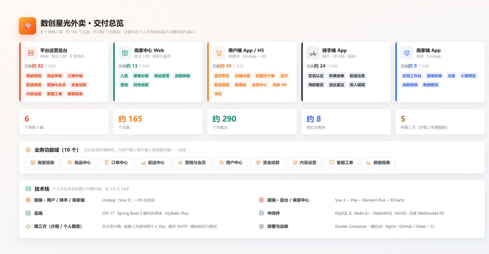

数创星光外卖 · 交付总览

**① 系统与端**

| # | 系统 / 端 | 形态 | 使用角色 | 页面量级 | 主要功能 |
| --- | --- | --- | --- | --- | --- |
| 1 | 平台运营后台 | Web（独立前端工程） | 超管 / 招商 / 商品运营 / 营销运营 /调度 / 客服 / 财务/ 数据分析 | 约 82 | 商家招商、商品审核、订单与售后仲裁、配送调度、营销与会员、资金结算、内容运营、客服工单、数据报表、系统管理 |
| 2 | 商家中心 Web | Web（独立前端工程） | 商家管理员 / 店长/ 店员 | 约 13 | 入驻、接单出餐、商品与门店管理、到店自取核销、营销、财务、评价 |
| 3 | 用户端 App / H5 | UniApp + H5 | 消费者 | 约 49 | 首页与附近、店铺点餐、双履约下单与支付、订单与配送追踪、取餐码、消息 IM、会员中心、评价 |
| 4 | 骑手端 App | UniApp | 骑手 | 约 24 | 实名认证、听单抢单、配送任务、导航取货、送达留证、收入与提现 |
| 5 | 商家端 App | UniApp | 商家 | 约 9 | 经营工作台、接单拒单、出餐、小票预览、自取核销、数据概览 |
| 6 | 后端服务 | Spring Boot 3 模块化单体 | — | — | 对 5 个前端端统一提供 REST API、WebSocket 与定时任务 |

说明：本表按**交付物**拆分（5 个前端端 + 1 套后端服务）；与 `2.1` 的「4 个业务端 + 2 个支撑体系」是**同一系统的两种视角**。

**② 页面与功能量级**

| 维度 | 数量 | 说明 |
| --- | --- | --- |
| 系统 / 端 | 6 | 5 个前端端 + 1 套后端服务 |
| 页面 | 约 165 | 用户端 49 / 骑手端 24 / 商家端 9 /商家中心 13 / 运营后台 82（跨端重复页面按端各计一次） |
| 功能点 | 约 290 | P0 必须完成、P1 建议完成、P2 选做，见 1.6 |
| 后台角色 | 8 | 超管、招商、商品运营、营销运营、调度、客服、财务、数据分析 |
| 业务功能域 | 10 | 见下表 ③ |
| 埋点事件 | 20+ | 见 9.10 |

**③ 业务功能域（10 个）**

| 功能域 | 覆盖内容 | 对应章节 |
| --- | --- | --- |
| 商家招商 | 入驻 / 资质 / 合同 / 门店 | 4.2 |
| 商品中心 | 品类 / 商品库 / 规格 / 估清 / 评价 | 4.3 |
| 订单中心 | 下单 / 履约 / 售后仲裁 / 异常池 | 4.4 |
| 配送中心 | 骑手 / 调度 / 轨迹 / 运费与围栏 | 4.5 |
| 营销与会员 | 券 / 满减 / 秒杀 / 会员 / 积分 | 4.6 |
| 用户中心 | 用户 / 分群 / 地址 / 钱包 | 4.7 |
| 资金结算 | 支付渠道 / 抽佣 / 结算 / 提现 | 4.8 |
| 内容运营 | 装修 / 广告位 / 消息模板 / 版本 | 4.9 |
| 客服工单 | 会话 / 工单 / 投诉 / FAQ | 4.10 |
| 数据报表 | 经营 / 流量 / 商品 / 财务 | 4.11 |

**④ 技术栈**

| 层次 | 选型 | 说明 |
| --- | --- | --- |
| 用户端 / 骑手端 / 商家端 | UniApp（Vue 3） | 一套代码输出 H5（必做）与 App（选做）；用户端另做 H5 自适应 |
| 平台运营后台 / 商家中心 | Vue 3 + Vite + Element Plus + ECharts | 两个独立前端工程：独立仓库、独立部署、独立域名 |
| 后端 | JDK 17 + Spring Boot 3（模块化单体） | 按业务域分包，预留微服务拆分能力 |
| 持久层 | MyBatis-Plus + MySQL 8 | 逻辑删除、分页插件、代码生成器 |
| 缓存与队列 | Redis 6+ / RabbitMQ | 缓存、分布式锁、延迟任务、削峰 |
| 实时通信 | 自建 WebSocket（IM 与订单消息） | 不依赖第三方 IM |
| 对象存储 | MinIO | 商品图、头像、小票、证件 |
| 第三方 | 支付宝沙箱 · 高德 / 百度地图个人Key · 邮件 SMTP · 模拟短信与推送 | 全部免费或沙箱，见 2.4 / 14.8 |
| 部署 | Docker Compose + Nginx | 一键启动全部中间件与服务 |

## 2. 系统总体架构与系统构成

### 2.1 系统构成（共 6 个系统）

本平台由 **4 个业务端 + 2 个支撑体系** 构成：

| 序号 | 系统名称 | 终端形态 | 主要使用者 | 说明 |
| --- | --- | --- | --- | --- |
| 1 | 平台运营后台 | Web（PC，独立前端工程） | 平台运营、招商、客服、财务、调度 | 全平台管理中枢，全新设计 |
| 2 | 商家中心（商户端） | Web（PC，独立前端工程）+ 商家端 App | 商家老板、店长、店员 | 与运营后台拆分为独立工程：独立仓库、独立部署、独立域名；按租户/角色隔离数据 |
| 3 | 用户端 App | Android / iOS / H5（小程序选做） | 消费者 | 全新设计，美团形态；支持配送与到店自取 |
| 4 | 骑手端 App | Android / iOS | 配送骑手 | 全新设计，接单-配送-结算 |
| 5 | 开放与第三方对接体系 | 服务端 | 第三方平台 | 支付宝沙箱、地图、邮件、对象存储 |
| 6 | 数据与运维支撑体系 | Web + 服务端 | 运维、技术 | 监控告警、日志、任务调度、配置中心 |

**前端工程划分**：**平台运营后台**与**商家中心 Web** 为两个**独立前端工程**，各自独立仓库、独立构建、独立部署与访问域名；用户端 App、骑手端 App 亦为独立工程。四个前端**共用同一套后端服务与权限模型**，通过角色与 `merchant_id` / `shop_id` 做数据隔离。

### 2.2 总体架构图

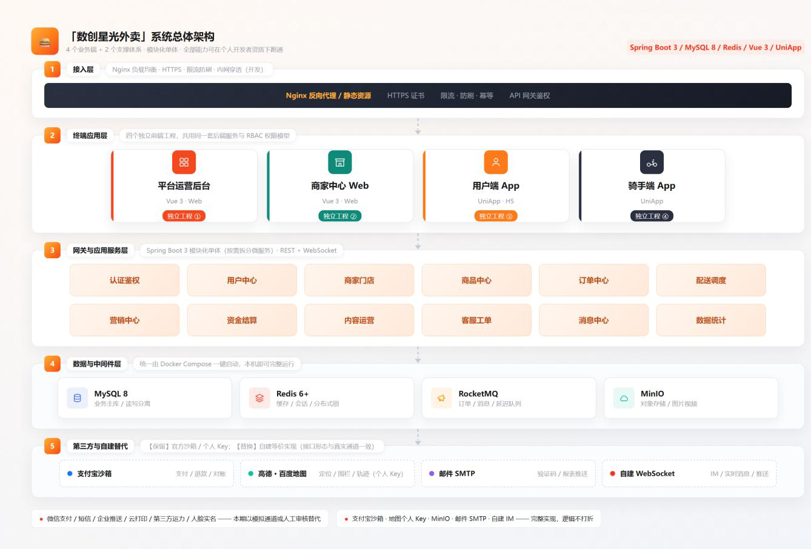

「数创星光外卖」系统总体架构

**架构要点**：平台由 **4 个业务端 + 2 个支撑体系**构成。四端为**独立前端工程**（独立仓库 / 构建 / 部署 / 域名），共用同一套 Spring Boot 3 模块化单体服务与 RBAC 权限模型，通过角色与 `merchant_id` / `shop_id` 做数据隔离。数据与中间件层由 Docker Compose 一键启动。

第三方对接严格遵循 `1.5` 的【保留】/【替换】/【取消】三分法：**【保留】**（支付宝沙箱、地图个人 Key、MinIO、自建 IM、邮件 SMTP）按正式需求完整实现，逻辑不打折；**【替换】**（微信支付、短信、企业

推送、云打印、人脸实名）以自建等价实现，保持接口形态与真实通道一致；**【取消】**（第三方运力、电子发票、电子合同、公众号运营）不进入本期范围。

### 2.3 后端模块划分（按新业务域重新规划）

| 模块 | 职责 |
| --- | --- |
| system | 用户、角色、菜单、部门、岗位、字典、租户与套餐、OAuth2、日志、邮件、公告 |
| infra | 代码生成、配置、文件（MinIO）、定时任务、监控、WebSocket、API 日志 |
| merchant | 商家入驻与审核、商家资料、资质、结算账户、商家等级 |
| store | 门店、营业状态、配送范围、门店装修、门店账号 |
| product | 品类、商品库、门店商品、规格 SKU、加料、估清、商品评价 |
| order | 购物车、下单、订单、状态机、售后、退款、仲裁、异常订单池 |
| delivery | 骑手、调度派单、配送单、轨迹、运费模板与配送费明细（核心新增；结算计算归属 settlement，避免职责重叠） |
| pay | 支付渠道抽象（支付宝沙箱 / 余额 / 模拟微信）、支付单、退款、对账 |
| settlement | 平台抽佣、商家结算、骑手结算、提现审核、资金流水（核心新增） |
| marketing | 优惠券、满减、折扣、秒杀、红包、签到、邀请、会员权益、积分 |
| member | 用户、会员等级、地址、钱包余额、账单、用户标签分群 |
| content | 首页装修、广告位、搜索运营、公告、App 版本管理 |
| service | 在线客服、工单、投诉处理、常见问题（核心新增） |
| message | 站内信、消息模板、自建 IM 会话、WebSocket 推送 |
| report | 经营报表、流量分析、商品/商家/骑手分析、财务报表 |

### 2.4 第三方对接清单（含个人可用性评估）

| 类别 | 用途 | 候选 | 个人可用性 | 结论 |
| --- | --- | --- | --- | --- |
| 支付 | 在线支付、退款、对账 | 支付宝沙箱 | 个人可注册开放平台、可用沙箱 | 【保留】 |
| 支付 | 在线支付 | 微信支付 V3 | 需企业商户号 | 【替换】 模拟支付通道 |
| 支付 | 在线支付 | 平台余额 | 自建 | 【保留】 |
| 地图 | 定位、地址解析、路径规划、配送围栏、轨迹 | 高德 / 百度开放平台 | 个人开发者 Key，含免费日配额 | 【保留】（注意配额） |
| 消息触达 | 站内信、订单通知、IM | 自建 WebSocket | 完全自建 | 【保留】 |
| 消息触达 | 短信验证码 | 阿里云/腾讯云短信 | 需企业实名 | 【替换】 邮件 SMTP /控制台模拟验证码 |
| 消息触达 | App 推送 | 个推 / 极光 | 需企业认证 | 【替换】 WebSocket + 本地通知 |
| 打印 | 后厨/前台小票 | 易联云等云打印 | 需购设备 + 企业 | 【替换】 小票预览 +模拟打印 |
| 存储 | 图片/文件 | MinIO（自建）、云OSS | 个人可实名开通云 OSS | 【保留】 默认 MinIO |
| 运力 | 第三方配送 | 达达 / 蜂鸟 | 需企业合作 | 【取消】 自建骑手运力 |
| 认证 | 骑手实名/人脸 | 三要素认证服务 | 需企业 | 【替换】 人工审核 |
| 税务 | 电子发票 | 税务服务商 | 需企业 | 【取消】 |
| 登录 | 微信/支付宝/Apple 登录 | 各开放平台 | 需企业认证应用 | 【替换】 手机号 + 模拟验证码 |
| 微信生态 | 公众号运营、小程序支付 | 微信开放平台 | 需认证/企业 | 【取消】 后台不设计该模块 |

### 2.5 核心领域模型（实体清单）

本节只到**实体与关系**层级；表结构、字段、索引在《详细设计说明书》中给出。

| 领域 | 核心实体 | 关键关系 |
| --- | --- | --- |
| 账号权限 | 平台用户、角色、菜单、租户、商家账号、骑手账号 | 用户 N:N 角色；账号归属租户 / 商家 / 门店 |
| 商家门店 | 商家(merchant)、品牌、门店(shop)、资质文件、结算账户 | 商家 1:N 门店；门店 1:1 结算账户 |
| 商品 | 品类、商品库(SPU)、规格(SKU)、加料组、门店商品、估清记录 | SPU 1:N SKU；门店商品引用商品库 |
| 交易 | 购物车、订单(order)、订单明细、订单状态流水、售后单、退款单 | 订单 1:N 明细；订单 1:1 配送单或自取单 |
| 配送 | 骑手、配送单、配送轨迹、派单记录 | 配送单 N:1 骑手；配送单 N:1 门店 |
| 资金 | 支付单、支付流水、退款流水、佣金规则、结算单、结算明细、提现单、资金流水 | 结算单 1:N 明细；支付单 1:1 订单 |
| 营销 | 优惠券模板、用户券、活动（满减/折扣/秒杀）、红包、会员神券包、积分账户、积分流水 | 用户券 N:1 券模板；活动 N:M 商品；券包 1:N 用户券 |
| 会员用户 | 用户、会员档案（等级 / 成长值）、地址、钱包、账单、标签分群 | 用户 1:1 会员档案、1:1 钱包；用户1:N 地址 |
| 内容客服 | 首页装修、广告位、搜索词、公告、App 版本、客服会话、工单、投诉、FAQ | 工单 N:1 订单 |
| 消息 | 消息模板、站内信、IM 会话、IM 消息、推送记录 | 会话 1:N 消息 |

## 3. 用户角色与权限模型

### 3.1 角色清单

| 端 | 角色 | 职责 | 权限范围 |
| --- | --- | --- | --- |
| 平台后台 | 超级管理员 | 全部功能 | 全平台 |
| 平台后台 | 招商 | 商家入驻审核、资质审核、合同登记 | 商家/门店 |
| 平台后台 | 商品运营 | 平台品类、商品库审核、内容装修、活动位 | 商品/内容/营销 |
| 平台后台 | 营销运营 | 优惠券、满减、秒杀、红包、补贴预算 | 营销 |
| 平台后台 | 调度 | 派单、改派、运力监控、异常订单干预 | 配送/订单 |
| 平台后台 | 客服 | 会话接待、工单、售后仲裁、投诉处理 | 订单/售后/客服 |
| 平台后台 | 财务 | 抽佣规则、商家/骑手结算、提现审核、对账 | 资金 |
| 平台后台 | 数据分析 | 报表查看与导出 | 只读报表 |
| 商家中心 | 商家管理员/店长/店员 | 商品、接单、出餐、门店设置 | 本商家/本门店 |
| 用户端 | 消费者 | 下单、支付、评价 | 本人数据 |
| 骑手端 | 骑手 | 接单、配送、收入与结算 | 本人数据 |

### 3.2 权限模型

- **RBAC**：用户 → 角色 → 菜单/按钮权限，后台可自定义角色与数据权限（全部 / 本部门 / 本部门及以下 / 仅本人 / 自定义）。

- **多租户隔离**：平台 / 商家两级租户，叠加 `merchant_id` + `shop_id` 数据隔离，杜绝越权访问。

- **数据脱敏**：客服角色查看用户手机号需脱敏（`1388888`），并记录操作日志。

- **审计**：所有后台关键操作（订单改价、退款、结算、派单、权限变更）写入操作日志，可追溯。

### 3.3 角色—权限矩阵（摘要）

| 功能域 | 超管 | 招商 | 商品运营 | 营销运营 | 调度 | 客服 | 财务 | 数据分析 | 商家 | 骑手 |
| --- | --- | --- | --- | --- | --- | --- | --- | --- | --- | --- |
| 商家 / 门店管理 | ✓ | ✓ | — | — | — | 只读 | 只读 | 只读 | 本商家 | — |
| 商品与品类 | ✓ | — | ✓ | 只读 | — | — | — | 只读 | 本店 | — |
| 订单与售后 | ✓ | — | — | — | ✓ | ✓ | 只读 | 只读 | 本店 | 本人单 |
| 配送与调度 | ✓ | — | — | — | ✓ | 只读 | — | 只读 | 只读 | 本人 |
| 营销 | ✓ | — | ✓ | ✓ | — | — | 只读 | 只读 | 申请制 | — |
| 资金与结算 | ✓ | — | — | 只读 | — | — | ✓ | 只读 | 本人 | 本人 |
| 内容与客服 | ✓ | — | ✓ | ✓ | — | ✓ | — | 只读 | — | — |
| 系统与权限 | ✓ | — | — | — | — | — | — | — | — | — |

"只读"= 仅查看不可修改；"本商家 / 本店 / 本人"= 受 `merchant_id` / `shop_id` / `user_id` 数据权限约束。完整"菜单—按钮"权限清单在《详细设计说明书》中展开。

## 4. 平台运营后台需求（全新设计）

**本章为完全重新设计的后台**，按本项目"平台级外卖平台"的业务模型组织，与第 5~7 章的用户端 / 骑手端 / 商家端功能一一对应，**不再照搬参考系统的模块划分**。可行性标记：【保留】= 可直接实现；【替换】= 用模拟/自建等价实现；【取消】= 本期不设计。

### 4.0 后台导航结构（总览）

平台运营后台

```
├─ 工作台（数据看板 / 待办 / 预警）
├─ 商家招商
│ ├─ 入驻申请
│ ├─ 商家管理
│ ├─ 门店管理
│ └─ 商家结算账户
├─ 商品中心
│ ├─ 平台品类
│ ├─ 商品库
│ ├─ 门店商品审核
│ ├─ 规格与加料模板
│ └─ 评价管理
├─ 订单中心
│ ├─ 订单列表 / 详情
│ ├─ 售后服务与仲裁
│ ├─ 异常订单池
│ └─ 订单规则配置
├─ 配送中心
│ ├─ 骑手管理（认证 / 档案 / 排班）
│ ├─ 调度中心（实时地图 / 派单 / 改派）
```

```
│ ├─ 配送单与轨迹
│ ├─ 运费与计费规则
│ └─ 配送范围与禁送区
├─ 营销中心
│ ├─ 优惠券（平台券 / 商家券）
│ ├─ 满减 / 折扣 / 秒杀
│ ├─ 红包 / 新客立减 / 配送费减免
│ ├─ 签到 / 邀请有礼
│ ├─ 会员与积分
│ └─ 营销效果分析
├─ 用户中心
│ ├─ 用户管理 / 标签分群
│ ├─ 会员等级
│ ├─ 地址管理
│ └─ 钱包与余额
├─ 资金中心
│ ├─ 支付渠道配置
│ ├─ 支付 / 退款流水
│ ├─ 佣金规则
│ ├─ 商家结算
│ ├─ 骑手结算
│ └─ 提现审核
├─ 内容运营
│ ├─ 首页装修
│ ├─ 广告位
│ ├─ 搜索运营
│ ├─ 消息模板与推送
│ └─ App 版本管理
├─ 客服与工单
├─ 数据报表
└─ 系统管理（用户 / 角色 / 菜单 / 租户 / 日志 / 基础设施）
```

### 4.1 工作台与数据看板

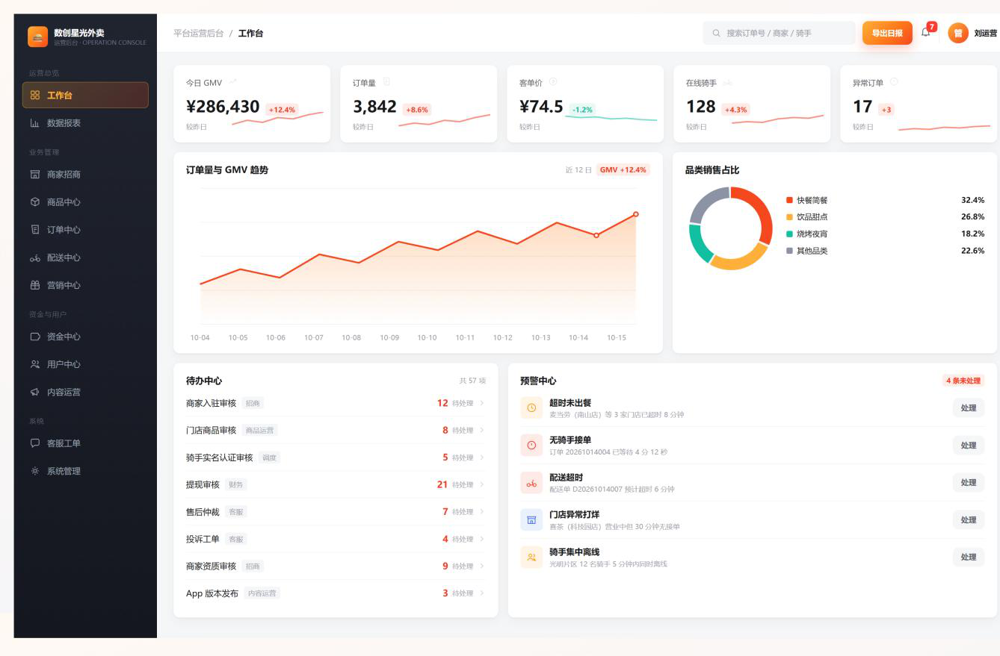

平台运营后台 · 工作台

工作台是运营人员的**每日入口**：顶部五张实时数据卡（GMV / 订单量 / 客单价 / 在线骑手 / 异常订单）反映经营大盘；中部为「订单量与 GMV 趋势 + 品类销售占比」；下部左侧为**待办中心**（招商审核、商品审核、骑手认证、提现审核、售后仲裁、投诉工单…），右侧为**预警中心**（超时未出餐、无骑手接单、配送超时、门店异常打烊、骑手集中离线），均可一键跳转处理。

| 功能 | 说明 | 可行性 |
| --- | --- | --- |
| 实时数据卡 | 今日 GMV、订单量、客单价、新增用户、在线骑手、进行中订单、异常订单数 | 【保留】 |
| 趋势图表 | 近 7/30 日订单量与 GMV 折线、时段分布热力图、品类占比（ECharts） | 【保留】 |
| 待办中心 | 商家入驻审核、资质审核、商品审核、提现审核、售后仲裁、投诉工单、骑手认证审核 | 【保留】 |
| 预警中心 | 超时未出餐、无骑手接单、配送超时、门店异常打烊、骑手集中离线 | 【保留】 |
| 快捷入口 | 常用功能跳转与自定义 | 【保留】 |

### 4.2 商家招商

| 模块 | 功能点 | 可行性 |
| --- | --- | --- |
| 入驻申请 | 申请列表、资料查看（营业执照、食品经营许可证、法人身份证、门店照片）、审核通过/驳回（含原因）、备注、通知商家 | 【保留】（替换：资质人工审核） |
| 商家管理 | 商家列表、详情、启用/停用、商家等级、经营品类、联系人、抽佣比例、经营数据概览、账号管理 | 【保留】 |
| 门店管理 | 门店列表、增删改、地址与经纬度（地图选点）、营业时间（支持多时段）、营业状态（营业/打烊/休息）、联系电话、门店图片/视频、配送方式（平台配送 / 到店自取；本期不含商家自配送）、起送价、配送费、打包费、预计出餐时长、门店公告 | 【保留】 |
| 到店自取 | 自取开关、自取营业时段、取餐码规则（前缀/位数/有效期）、自取备餐时长、自取优惠设置（如自取立减）、自取订单核销记录与超时未取处理 | 【保留】 |
| 配送范围 | 门店配送围栏（圆形/多边形地图绘制）、起送距离、超范围提示（自取订单不受配送围栏限制） | 【保留】 |
| 门店装修 | 门店首页（招牌、橱窗、推荐分类、店内活动位）配置与预览 | 【保留】 |
| 连锁管理 | 品牌 → 门店层级、品牌统一配置下发 | 【保留】 |
| 商家结算账户 | 账户信息、开户信息、合同附件、生效期（替换：仅登记，不做真实打款） | 【替换】 |
| 商家后台账号 | 商家主账号、子账号与角色分配 | 【保留】 |

### 4.3 商品中心

| 模块 | 功能点 | 可行性 |
| --- | --- | --- |
| 平台品类 | 一级/二级品类树、图标、排序、启停（供首页金刚区与搜索使用） | 【保留】 |
| 商品库 | 平台商品模板库、商品列表、增删改、上下架、多规格 SKU、加料组、餐盒费、库存、限购、起售量、图片与详情富文本、标签（招牌/新品/热销）、排序权重 | 【保留】 |
| 门店商品审核 | 门店上架商品/改价审核（可配置为免审） | 【保留】 |
| 规格与加料模板 | 模板复用（杯型/温度/糖度等）与模板管理 | 【保留】 |
| 估清管理 | 估清商品查询、批量恢复、估清原因统计 | 【保留】 |
| 评价管理 | 评价列表（按门店/商品/骑手维度）、标签库、商家回复查看、审核、隐藏、置顶、差评申诉与跟踪 | 【保留】 |
| 素材库 | 图片/视频素材分组管理 | 【保留】 |

### 4.4 订单中心

| 模块 | 功能点 | 可行性 |
| --- | --- | --- |
| 订单列表 | 多条件筛选（订单号、用户、商家、门店、骑手、状态、支付方式、时间范围）、导出 | 【保留】 |
| 订单详情 | 商品明细、金额明细（商品/餐盒费/配送费/优惠/实付）、用户信息、地址、支付信息、配送信息、会话记录、完整状态时间轴与操作日志 | 【保留】 |
| 订单干预 | 改价、取消、强制完成、改派骑手、延长/缩短承诺送达时间、补发优惠券（自取订单无配送相关操作） | 【保留】 |
| 到店自取订单 | 自取订单标识（免配送费）、取餐码生成与查询、备餐完成通知、超时未取处理、核销记录 | 【保留】 |
| 售后服务与仲裁 | 退款/售后申请列表、责任判定（商家/骑手/平台/用户）、平台介入、部分退款、补偿发放、进度跟踪 | 【保留】（替换：退款走支付宝沙箱原路或余额） |
| 异常订单池 | 无骑手接单、超时未出餐、配送超时、用户拒收、联系不上用户、地址异常，支持一键处理 | 【保留】 |
| 订单规则配置 | 自动接单开关、商家拒单上限、超时自动取消/自动完成阈值、催单限频、取消规则（谁可取消/扣费规则） | 【保留】 |
| 订单统计 | 时段分布、来源分布、取消率、异常率 | 【保留】 |

### 4.5 配送中心（核心新增）

| 模块 | 功能点 | 可行性 |
| --- | --- | --- |
| 骑手认证审核 | 认证申请列表、证件照查看（身份证/健康证）、审核通过/驳回（原因）、人工审核 | 【替换】 |
| 骑手档案 | 骑手列表、详情、实名信息、联系方式、车型、接单上限、启用/停用、拉黑、评分与准时率 | 【保留】 |
| 健康证管理 | 有效期登记、到期提醒、过期自动限制接单 | 【保留】 |
| 骑手排班与考勤 | 排班表、上线时段、接单上限、考勤统计、请假登记 | 【保留】 |
| 调度中心 | 实时地图（在线骑手 / 待派单 / 配送中订单分布）、自动派单策略配置（距离权重、负载均衡、骑手评分、订单超时优先）、手动派单/改派/撤销、转单、派单失败兜底 | 【保留】 |
| 抢单大厅配置 | 可抢单订单范围、抢单半径、单量上限、抢单优先级规则 | 【保留】 |
| 配送单管理 | 配送单列表、详情、状态流转、轨迹回放、超时记录、申诉处理 | 【保留】 |
| 运费与计费 | 运费模板（距离区间计价、时段加价、恶劣天气加价、楼层/重量附加）、骑手配送费规则（基础费 +距离费 + 时段/天气补贴）、补贴与奖惩规则 | 【保留】 |
| 配送范围 | 平台服务区域、门店配送围栏、禁送区域、超区拦截 | 【保留】 |
| 第三方运力接入 | 达达/蜂鸟对接 | 【取消】 仅预留接口说明 |

### 4.6 营销中心

| 模块 | 功能点 | 可行性 |
| --- | --- | --- |
| 优惠券 | 平台券/商家券、类型（满减/折扣/无门槛）、门槛与适用范围（全平台/指定商家/指定商品）、发放方式（领券中心/新人券/定向发放/活动发放）、预算与库存、有效期（固定/领取后 N 天）、核销记录、作废 | 【保留】 |
| 满减活动 | 平台满减、商家满减、阶梯满减、叠加规则、活动时间 | 【保留】 |
| 折扣活动 | 单品折扣、分类折扣、限购 | 【保留】 |
| 秒杀 / 限时特价 | 场次配置（开始/结束时间）、商品与数量、限购、预热提醒、库存独立 | 【保留】（练习重点：并发扣减） |
| 红包 | 拼手气红包、分享红包、新人红包、领取与核销记录、风控防刷 | 【保留】 |
| 新客立减 / 首单优惠 | 规则配置、名额与预算、效果统计 | 【保留】 |
| 配送费减免 | 满额免配送费、首单免配送费、会员免配送费 | 【保留】 |
| 签到有礼 | 连续签到规则、奖励配置（积分/券）、补签规则 | 【保留】 |
| 邀请有礼 | 邀请码/邀请海报、奖励规则（邀请人/被邀请人）、防刷与限制 | 【保留】 |
| 会员等级体系 | 六档等级（普通 / 白银 / 黄金 / 铂金/ 黑金 / 黑钻）配置、成长值门槛、小星级、升级与降级规则、等级分布 | 【保留】 |
| 会员权益 | 按等级配置神券张数、免配送费次数、会员专享价、专属客服、生日礼遇等权益项与发放周期 | 【保留】 |
| 会员神券包 | 会员付费购买的无门槛神券券包（如2.99 元 6 张 5 元券 / 年卡），购买、发放、核销、退款 | 【保留】（替换：支付走模拟通道） |
| 成长值规则 | 成长值获取（消费 1 元 = 1 成长值 /签到 / 评价 / 邀请）与扣减规则、统计周期（近 365 天）、季度更新节点 | 【保留】 |
| 会员日与专享 | 会员日、会员专享价、联合商家权益 | 【保留】 |
| 积分体系 | 积分获取规则（下单/签到/评价/邀请）、消耗规则、过期规则 | 【保留】 |
| 积分商城 | 积分商品（积分或积分+金额）、库存、上下架、兑换订单、发货/自提 | 【保留】 |
| 充值活动 | 充值档位、赠送金额、充值记录 | 【保留】（替换：充值为模拟入账） |
| 营销效果分析 | 券核销率、活动带来的订单与GMV、成本与 ROI | 【保留】 |

### 4.7 用户中心

| 模块 | 功能点 | 可行性 |
| --- | --- | --- |
| 用户管理 | 用户列表、详情（消费画像：订单数/客单价/最近下单/偏好品类）、编辑、禁用、拉黑 | 【保留】 |
| 用户标签与分群 | 标签定义、自动打标（高频/沉默/新客）、人群分群（用于定向发券与活动） | 【保留】 |
| 会员等级 | 六档等级配置（成长值门槛、小星级、专享折扣与权益）、升级 / 降级规则、季度更新节点、会员列表 | 【保留】 |
| 会员成长值 | 用户成长值明细、获取与扣减记录、手工调整（需审批与日志） | 【保留】 |
| 会员神券包 | 会员购买的券包记录、发放与核销明细、退款处理 | 【保留】 |
| 地址管理 | 用户收货地址列表、查看、导出、异常地址标记 | 【保留】 |
| 钱包与余额 | 余额查询、充值记录、消费/退款/调整流水、手工调账（需审批与日志） | 【保留】 |
| 用户资产 | 持有的优惠券/红包/积分明细查询与补发 | 【保留】 |
| 用户反馈 | 意见反馈列表、回复、处理状态 | 【保留】 |

### 4.8 资金中心

| 模块 | 功能点 | 可行性 |
| --- | --- | --- |
| 支付渠道配置 | 支付宝（沙箱：APPID、应用私钥、支付宝公钥、签名方式、回调地址、沙箱开关）、微信（配置项完整保留，运行时切换模拟通道）、余额支付；渠道启停与优先级 | 【保留】/【替换】 |
| 支付流水 | 支付单列表、状态、关联订单、渠道、交易号、回调记录 | 【保留】 |
| 退款流水 | 退款单列表、状态、渠道退款号、失败重试 | 【保留】（替换：模拟微信退款走本地流水） |
| 对账 | 与支付宝沙箱对账（下载对账单、比对差异、差异处理） | 【保留】 |
| 技术服务费（佣金） | 按商家 / 品类 / 活动三级配置佣金比例、生效时间与优先级；命中优先级：活动级 > 商家级 > 品类级 > 全局默认 | 【保留】 |
| 履约服务费 | 选择平台配送时产生，按距离 / 时段/ 天气 / 重量阶梯计价（与运力成本挂钩）；自配送不计 | 【保留】 |
| 抽佣计算明细 | 每单抽佣基数、命中规则、比例与金额明细，可按商家 / 品类 / 时间导出核对 | 【保留】 |
| 商家结算 | 结算周期配置（默认 T+1，可改周结/月结）、结算账单生成、结算明细（营业额 - 抽佣 - 平台承担优惠 +商家承担优惠 + 退款冲抵，含自取订单）、结算单导出、打款登记 | 【替换】打款为模拟 |
| 骑手结算 | 配送费明细、各类补贴、罚款扣款、结算周期（默认日结，可改周结）、结算单、打款登记 | 【替换】打款为模拟 |
| 提现审核 | 商家/骑手提现申请、审核（通过/驳回）、状态流转、到账登记 | 【替换】模拟打款 |
| 资金流水与报表 | 平台流水、佣金收入、补贴支出、优惠券成本、利润概览 | 【保留】 |
| 发票 | — | 【取消】 需税务对接，不设计该模块 |

**佣金规则（参考美团外卖费率结构）**佣金拆分为**技术服务费（佣金）与履约服务费**两部分，商家可清晰核算每一笔构成：品类

技术服务费（佣金）

说明

美食餐饮（正餐 / 快餐 / 小吃）

6% ~ 8%平台主力品类，费率居中

饮品甜品（奶茶 / 咖啡 / 烘焙）

5.5% ~ 7.5%

高毛利、高频次

生鲜果蔬 / 超市便利3% ~ 5%

低毛利，费率最低

医药健康

5% ~ 8%

合规品类，需资质鲜花 / 蛋糕

8% ~ 12%

高客单、非高频

其他零售（日用 / 数码配件）

5% ~ 15%按子类目细分

**履约服务费**：起步价 + 距离费（每 0.5km 加价）+ 时段加价（高峰 / 夜间）+ 恶劣天气加价 + 重量与楼层附加；**自取单与自配送不计履约服务费**。**活动加佣**：参与平台大促（满减 / 秒杀 / 会员日）可按活动单独设置费率，**优先级高于商家合同费率**。**商家级差异**：连锁 / 品牌商家可按合同单独约定费率；新店支持**前 3 个月佣金减免**（后台可配）。

**综合成本参考**：商家实际承担 = 技术服务费（6%~8%）+ 履约服务费（约 3~7 元/单）+ 商家自设补贴，综合比例约 **15% ~ 25%**；本平台所有费率均**后台可配**，不写死在代码中。**结算出账口径**

**商家**：默认 `T+1`（周结 / 月结可配）。系统**每日 02:00** 生成「前一日 00:00–24:00」的结算账单（营业额 − 抽佣 − 平台承担优惠 + 商家承担优惠 + 退款冲抵，**含自取订单与自取立减**）；审核通过后模拟打款。

**骑手**：默认**日结**（周结可配）。**每日 02:00** 生成前一日配送账单（Σ 配送费 + 补贴 + 小费 − 罚款），**T+1 到账**，可发起提现（本期为模拟打款）。

处于**售后期**内的订单金额不参与结算，售后结束且无未结售后单后才计入可结算金额（见 `8.8`）；已结算订单发生退款，计入下一期「负项」冲抵。

### 4.9 内容运营

| 模块 | 功能点 | 可行性 |
| --- | --- | --- |
| 首页装修 | 轮播 Banner、金刚区（品类入口，关联第 4.3 节平台品类）、楼层（秒杀/神券/推荐店铺/猜你喜欢）、推荐位排序、跳转配置（商品/店铺/活动/页面）、生效时间、投放人群、所见即所得预览 | 【保留】 |
| 广告位管理 | 广告位定义（首页轮播/弹窗/启动图/店铺页）、素材、跳转、生效时间、投放统计 | 【保留】 |
| 搜索运营 | 默认搜索词、热搜词、联想词、置顶结果、搜索屏蔽词 | 【保留】 |
| 消息模板与推送 | 站内信模板、消息模板（订单类/营销类/系统类）、变量配置、推送记录、WebSocket 下发日志 | 【替换】 推送通道为自建 |
| 公告管理 | 公告列表、富文本编辑、发布/撤回、已读统计 | 【保留】 |
| App 版本管理 | 端（用户端/骑手端/商家端）、版本号、更新说明、下载地址、强制更新、灰度比例 | 【保留】 |

### 4.10 客服与工单

| 模块 | 功能点 | 可行性 |
| --- | --- | --- |
| 在线客服 | 客服工作台（会话列表、接待、转接、结束会话）、快捷回复话术、会话记录查询 | 【保留】（基于自建 IM） |
| 工单管理 | 工单类型（订单问题/退款/配送/投诉/建议）、工单流转与指派、时限与升级、处理记录 | 【保留】 |
| 投诉处理 | 投诉单列表、责任判定、处理结果、回访、拉黑/封禁联动 | 【保留】 |
| 常见问题 | FAQ 分类与条目维护（对应用户端"帮助中心"） | 【保留】 |
| 客服绩效 | 接待量、响应时长、满意度、工单办结率 | 【保留】 |

### 4.11 数据报表

| 模块 | 说明 | 可行性 |
| --- | --- | --- |
| 经营总览 | GMV、订单量、客单价、下单用户数、复购率、退款率（按日/周/月） | 【保留】 |
| 流量分析 | 首页曝光、点击、加购、下单转化漏斗；来源分析 | 【保留】 |
| 商品分析 | 销量榜、滞销商品、品类销售占比、加料偏好 | 【保留】 |
| 商家/门店排行 | 营业额、订单量、评分、出餐时长、取消率排行 | 【保留】 |
| 用户分析 | 新增、活跃、留存、复购、画像（性别/地区/品类偏好） | 【保留】 |
| 骑手分析 | 接单量、准时率、评分、在线时长、配送时长分布 | 【保留】 |
| 营销分析 | 券/红包/活动的发放、核销、带来的GMV 与成本 | 【保留】 |
| 财务报表 | 佣金收入、结算支出、补贴与优惠成本、利润 | 【保留】 |
| 自定义报表与导出 | 报表导出 Excel、定时报表推送（邮件） | 【保留】 |

### 4.12 系统管理与基础设施

**说明**：本部分不要求复刻参考系统，而是按新系统的角色、租户与数据模型重新规划；实现时可复用成熟的开源能力。**标注"（脚手架）"的条目属于脚手架自带能力，不是业务需求，个人练手可按需裁剪**。

| 模块 | 功能点 | 可行性 |
| --- | --- | --- |
| 用户管理 | 后台用户、部门关联、分配角色、重置密码、导入导出 | 【保留】 |
| 角色与权限 | 角色、菜单权限、按钮权限、数据权限范围 | 【保留】 |
| 菜单管理 | 菜单树、路由/组件/权限标识、排序、显隐 | 【保留】 |
| 部门与岗位 | 组织架构、岗位管理 | 【保留】 |
| 字典与地区 | 数据字典、省市区行政数据 | 【保留】 |
| 租户与套餐 | 租户（平台/商家）、套餐可访问范围、有效期 | 【保留】 |
| OAuth2 | 客户端管理、令牌管理（强制下线） | 【保留】 |
| 通知公告 | 公告发布与已读统计 | 【保留】 |
| 站内信 | 站内消息模板与推送记录 | 【保留】 |
| 邮件管理 | 邮箱账号（SMTP）、邮件模板、邮件日志 | 【保留】 |
| 短信管理 | 渠道、模板、日志 | 【替换】 渠道改为邮件/控制台模拟，保留表结构 |
| 日志中心 | 登录日志、操作日志、API 访问日志、API 错误日志 | 【保留】 |
| 代码生成 | 数据表导入、字段配置、生成并下载代码（脚手架） | 【保留】 |
| 数据源 / 配置 / 文件 | 多数据源（脚手架，本期单库即可）、系统参数、文件管理（MinIO）与文件配置 | 【保留】 |
| 定时任务 | 任务配置、Cron、启停、执行日志、手动执行 | 【保留】 |
| 监控 | Redis / 服务 / 数据库 / 链路追踪（脚手架，SkyWalking 可选） / Swagger / WebSocket 连接管理 | 【保留】 |
| 表单构建 | 拖拽式表单设计器（脚手架，非业务需求，可选） | 【保留】 |

### 4.13 商家中心导航结构（独立工程）

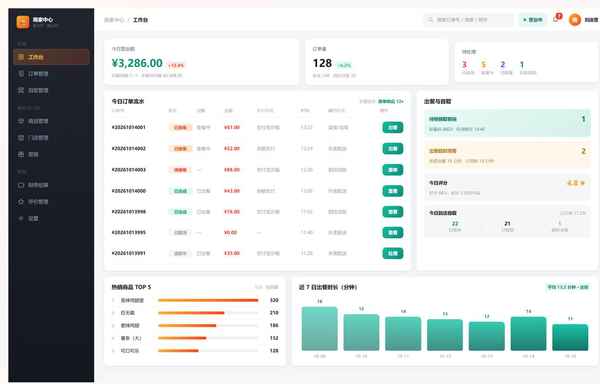

商家中心 Web · 经营工作台

商家中心视觉上以**深青绿**为主题色，与平台运营后台（橙色）区分，采用「浅色内容区 + 深色侧边栏」布局。工作台聚合「今日营业额 / 订单量 / 待处理」，并提供**今日订单流水**（含履约方式与自取标识）、**出餐与自取**（待核销取餐码、出餐超时预警、今日评分、自取占比）、**热销商品 TOP 5** 与**近 7 日出餐时长**，让店长在不切页面的前提下完成"看盘 → 处置"闭环。

商家中心为**独立前端工程**，与平台运营后台**共用后端与 RBAC，但菜单体系与访问域名独立**，数据范围限定为"本商家 / 本门店"。

商家中心（`Web`，独立工程）

```
├─ 工作台（今日营业额 / 待处理订单 / 经营概览）
├─ 订单管理（待接单 / 备餐中 / 待取餐 / 已完成 / 退款售后）
├─ 自取管理（自取订单 / 取餐码核销 / 备餐完成通知）
├─ 商品管理（上下架 / 规格 / 估清 / 改价申请）
├─ 门店管理（营业状态 / 营业时间 / 配送范围 / 起送价与配送费 / 到店自取配置）
├─ 营销（店铺满减 / 优惠券申请 / 参加平台活动）
├─ 财务（营业额 / 抽佣明细 / 结算单 / 提现申请）
├─ 评价（查看与回复 / 差评申诉）
└─ 设置（账号与子账号 / 消息通知 / 小票预览设置）
```

## 5. 用户端外卖 App 需求（全新设计）

**设计原则**：整体信息架构、交互与视觉参考美团外卖；强调"快"（下单路径短）、"准"（配送可追踪）、"通"（与商家/骑手消息互通）。 本期主渠道为 **H5 + App（Android/iOS）**，微信小程序为选做。

### 5.1 信息架构（底部 Tab）

```
底部 Tab：首页 │ 附近 │ 订单 │ 消息 │ 我的
```

| Tab | 定位 |
| --- | --- |
| 首页 | 搜索 + 广告 + 分类 + 推荐店铺流 |
| 附近 | 地图模式找店（按距离/品类筛选，地图气泡展示店铺） |
| 订单 | 全部订单分状态 Tab，含进行中订单悬浮卡片 |
| 消息 | 系统通知 + 会话列表（商家/骑手 IM），未读红点 |
| 我的 | 个人中心、钱包、优惠券、地址、设置 |

### 5.2 功能模块明细

#### 5.2.1 启动与账号

| 功能 | 说明 | 可行性 |
| --- | --- | --- |
| 启动页/引导页 | 品牌启动页、首次安装引导 | 【保留】 |
| 定位授权 | 首次进入申请定位权限，失败可手动选城市 | 【保留】 |
| 手机号登录 | 验证码登录/注册一体 | 【替换】 开发环境固定验证码或邮件验证码 |
| 第三方登录 | 微信一键登录 / 支付宝登录 / Apple登录 | 【替换】 保留接口扩展位，本期不接；改为账号密码 + 模拟验证码 |
| 隐私协议 | 用户协议、隐私政策弹窗确认（合规必需） | 【保留】 |
| 注销账号 | 注销申请与冷静期 | 【保留】 |

#### 5.2.2 首页

| 功能 | 说明 |
| --- | --- |
| 顶部搜索栏 | 当前城市展示（本期单城市运营，城市切换仅预留入口，见 1.4）+ 搜索入口 |
| 轮播广告 | 平台活动/广告位轮播（后台 4.9 配置） |
| 金刚区分类 | 品类图标入口（后台 4.3 平台品类驱动） |
| 限时活动区 | 秒杀、神券、新人专享、满减专区 |
| 附近好店推荐 | 卡片流：头图、名称、评分、月售、起送价、配送费、预计送达、距离、活动标签 |
| 猜你喜欢 | 个性化推荐商品流 |
| 排序筛选 | 综合 / 距离最近 / 销量最高 / 评分最高 / 起送价最低 |
| 下拉刷新/上拉加载 | 分页加载 + 骨架屏 |

#### 5.2.3 搜索

| 功能 | 说明 |
| --- | --- |
| 搜索入口 | 首页搜索栏、附近页搜索 |
| 搜索建议 | 联想词、历史搜索、热门搜索（后台 4.9 配置） |
| 搜索结果 | 店铺 Tab / 商品 Tab 双维度 |
| 结果筛选 | 品类、人均、距离、评分、优惠、配送方式 |
| 空结果推荐 | 推荐相近品类 |

#### 5.2.4 店铺详情页

| 功能 | 说明 |
| --- | --- |
| 店铺信息 | 头图、店名、评分（口味/包装/配送）、月售、公告、营业时间、地址、距离、电话 |
| 店铺活动 | 满减、折扣、新客立减、配送费减免、领券 |
| 商品分类锚点 | 左分类 + 右商品联动；店内搜索 |
| 商品卡片 | 图片、名称、描述、月售、规格、加料、价格、加购按钮、估清状态 |
| 规格/加料弹窗 | 规格单选/多选、加料多选、数量、小计、加入购物车 |
| 购物车栏 | 底部悬浮：件数、合计、去结算；可展开清单；一键清空 |
| 评价区 | 评价列表（标签筛选、图片、评分）、商家回复 |
| 商家信息 | 资质、门店位置地图、举报入口 |

#### 5.2.5 购物车与结算

| 功能 | 说明 |
| --- | --- |
| 购物车 | 清单、增减、删除、金额明细 |
| 履约方式 | 外卖配送 / 到店自取（互斥切换）：切换到自取后，地址区变为门店信息（门店名/地址/电话/营业时间）与自取人手机号，并展示预估备餐完成时间 |
| 配送方式 | 立即送出 / 预约时间送达（仅配送单；自取单不显示） |
| 收货地址 | 选择/新增、地图选点、门牌号、标签（家/公司）、定位门牌号（自取单不填地址） |
| 优惠 | 优惠券、红包、会员折扣、备注（口味/餐具份数）、自取立减（若门店已配置） |
| 费用明细 | 起送价校验、配送费实时计算（按后台 4.5 运费模板，自取免配送费）、打包费、优惠抵扣、实付 |
| 提交订单 | 生成订单（配送单 / 自取单）、进入支付 |
| 支付方式 | 支付宝（沙箱）、微信（模拟通道）、余额、组合支付 |
| 支付结果 | 配送单 → 进入订单详情并开启配送追踪；自取单 → 展示取餐码与门店导航；失败 → 重试/取消 |

#### 5.2.6 订单与配送

| 功能 | 说明 |
| --- | --- |
| 订单列表 | Tab：全部 / 待付款 / 待接单 / 进行中 / 待评价 / 退款售后。口径说明：配送单在「进行中」下含备餐中 / 待取货 / 配送中 / 已送达；自取单含备餐中 / 待取餐，自取单无「待收货」状态（见 8.9） |
| 进行中订单卡片 | 配送单：状态、倒计时、骑手位置、催单、联系骑手；自取单：取餐码、门店导航、预计备餐完成时间 |
| 订单详情 | 配送单时间轴（下单→支付→接单→出餐→取货→配送中→送达→完成）；自取单时间轴（下单→支付→接单→备餐中→待取餐→已取餐→完成）；商品与金额明细、地址/取餐信息、备注、支付信息 |
| 实时配送追踪 | 地图展示骑手位置与轨迹、预计送达时间、骑手头像/姓名/评分、配送进度（仅配送单） |
| 取餐码 | 自取单展示取餐码（大字 + 二维码），支持"我已取餐"确认、门店导航、一键联系商家 |
| 订单操作 | 取消订单（含退款）、催单、修改地址（未出餐前，仅配送单）、联系商家、联系骑手（配送单）、申请退款、申请售后、再来一单、去评价 |
| 退款/售后 | 选择退款商品与原因、上传凭证、退款进度、协商记录 |
| 催单 | 一键催单，通知商家与骑手，限频（规则由后台 4.4 配置） |
| ~~开发票~~ | 【取消】 需税务对接，个人不可行 |

#### 5.2.7 消息中心（重点新增）

| 功能 | 说明 | 可行性 |
| --- | --- | --- |
| 消息聚合 | 顶部聚合入口：系统通知 / 订单消息/ 优惠活动 / 会话 | 【保留】 |
| 系统通知 | 平台公告、活动通知 | 【保留】 |
| 订单消息 | 订单状态变更、支付结果、退款进度、配送提醒 | 【保留】 |
| 会话列表 | 与商家、骑手聊天会话列表，未读数、最近消息 | 【保留】 |
| IM 聊天 | 文字、表情、图片、订单卡片、常用语、位置；离线消息补推 | 【保留】（自建 WebSocket） |
| 未读管理 | 红点/角标、全部已读、删除会话 | 【保留】 |
| 消息推送 | 订单节点实时提醒（含声音） | 【替换】 WebSocket 长连接 + 轮询兜底 + 端上本地通知 |
| 推送设置 | 用户可开关各类通知 | 【保留】 |

#### 5.2.8 评价体系

| 功能 | 说明 |
| --- | --- |
| 订单评价 | 综合评分 + 口味/包装/配送分项 + 标签 + 图片 + 文字+ 匿名 |
| 骑手评价 | 单独评分与打赏（【替换】 打赏为模拟金额） |
| 追评 | 完成评价后可追加 |
| 我的评价 | 评价列表、查看商家回复、删除 |

#### 5.2.9 我的（个人中心）

| 功能 | 说明 |
| --- | --- |
| 个人信息 | 头像、昵称、手机号、性别、生日 |
| 我的钱包 | 余额、充值（档位+赠送）、余额明细 |
| 优惠券/红包 | 可用/已用/已过期，去使用 |
| 我的积分 | 积分余额、明细、积分商城入口、签到 |
| 会员中心 | 会员等级与成长值进度、等级体系、权益中心（神券 /免配送费 / 专属客服 / 生日礼遇）、神券包购买、成长值任务（见 5.2.11 / 5.3.9） |
| 收货地址 | 列表、增删改、设为默认 |
| 我的评价 | 见 5.2.8 |
| 我的收藏 | 收藏的店铺/商品 |
| 客服与帮助 | 在线客服、常见问题（后台 4.10 维护）、意见反馈、投诉建议 |
| 设置 | 消息通知设置、清除缓存、关于我们、隐私协议、注销账号、退出登录 |

#### 5.2.10 营销互动

| 功能 | 说明 |
| --- | --- |
| 签到有礼 | 每日签到领积分/优惠券，连续签到加码 |
| 天天神券 | 领券中心，每日限领 |
| 邀请有礼 | 分享邀请码/海报，邀请好友得奖励 |
| 拼手气红包 | 下单后分享红包给好友 |
| 分享 | 分享店铺/商品，生成海报（H5 内分享为复制链接/模拟） |
| 活动推送 | 活动通知通过站内消息与消息中心送达 |

#### 5.2.11 会员体系（参考美团会员）

会员是用户端**留存与复购**的核心抓手。本平台参考**美团会员体系**设计为「**成长值驱动的等级会员**」：消费与做任务累积成长值，等级越高、权益越多。

**① 等级与成长值门槛**

| 等级 | 成长值门槛 | 小星级 | 核心权益（示例） |
| --- | --- | --- | --- |
| 普通 | 0 | ★☆☆ | 基础下单与评价 |
| 白银 | 1000 | ★☆☆ | 每月 2 张无门槛神券、1次免配送费 |
| 黄金 | 2500 | ★★☆ | 每月 4 张无门槛神券、3次免配送费 |
| 铂金 | 5000 | ★★☆ | 每月 15 张神券、6 次免配送费、专属客服 |
| 黑金 | 10000 | ★★★ | 每月 15 张神券、会员专享价、生活类权益 |
| 黑钻 | 30000 | ★★★ | 每月 25 张神券、可购低价神券年卡、无限次免配送费、专属客服 |

**② 成长值规则**

- **获取**：每消费 1 元 = 1 成长值；每日签到 +10；完成评价 +20/单；邀请好友首单 +50/人。

- **统计与更新**：按**近 365 天**成长值总和判定等级，**每季度首日**更新一次；新周期按最新成长值重新判定等级。

- **与积分区分**：**成长值只累加、不消耗**（决定等级）；**积分可消耗**（兑换积分商城商品）。两套体系并存、互不影响（见 `4.6`）。

**③ 会员神券（会员核心权益）**

- **免费神券**：全体会员可领取的**有门槛**神券（如满 30 减 5）。

- **付费神券包**：会员以低价购买**无门槛**神券券包（如 2.99 元得 6 张 5 元无门槛券；高等级会员可购年卡），支持膨胀为更大面额。

- 券包支付走**模拟通道**（见 `1.5`），订单、发放与核销记录真实落库。

**④ 会员专享**

- 会员专享价、会员日加码、免配送费次数、生日礼遇、专属客服入口。

- 等级、门槛、权益项与神券包价格**全部由后台** `4.6` **/** `4.7` **配置**，前端仅按等级渲染，不允许写死。

### 5.3 用户端关键页面原型图（高保真视觉稿）

本章页面均为**高保真 UI 视觉稿**，按 `5.4` 设计规范（品牌橙金渐变、**方正小圆角**、紧凑黑体、细描边线性图标、柔和阴影与渐变质感）输出，用于确认信息层级、视觉风格与组件规范。 完整视觉稿清单见`assets/ui/`，命名规则：章节号`-`序号`-`端`-`页面名`.png`。

#### 5.3.1 首页

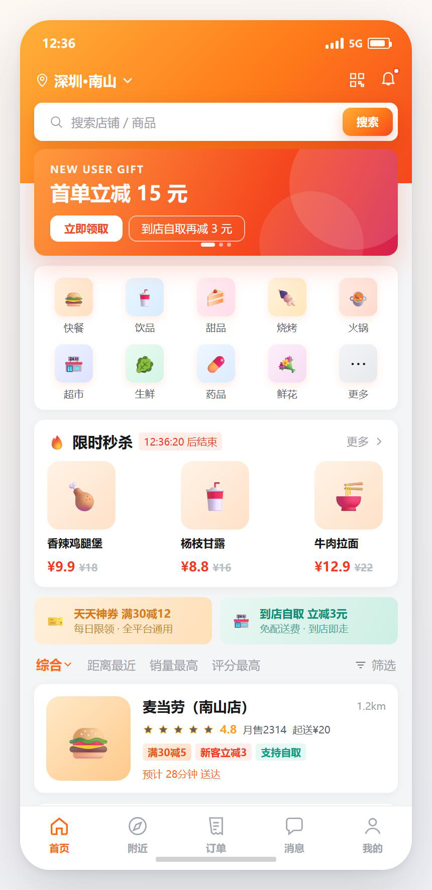

用户端 · 首页

**信息层级**：顶部城市 + 搜索栏（品牌渐变头部）→ 新客立减 Banner（含"到店自取再减 3 元"入口）→金刚区品类（10 格，由后台 `4.3` 平台品类驱动）→ 限时秒杀（倒计时 + 商品横滑）→ 天天神券 / 到店自取专区 → 排序筛选 → 附近好店卡片流（含评分、月售、起送价、**支持到店自取**标签、预计送达）。**底部 Tab**：首页 / 附近 / 订单 / 消息 / 我的。

#### 5.3.2 店铺详情页

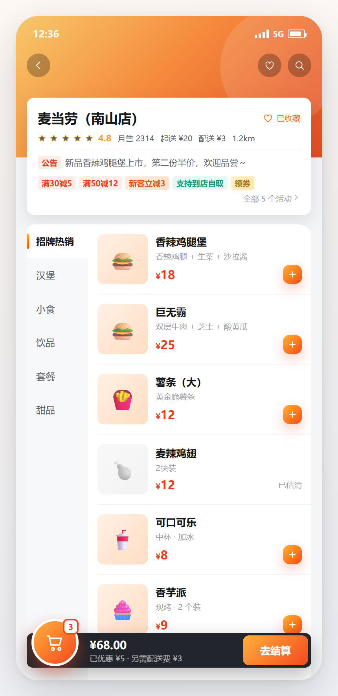

用户端 · 店铺详情

**信息层级**：店铺头图（含返回 / 收藏 / 店内搜索）→ 店铺信息卡（评分、月售、起送价、配送费、距离、公告）→ 活动标签行（满减 / 新客立减 / **支持到店自取** / 领券）→ 左分类锚点 + 右商品联动列表（图片、名称、描述、价格、加购按钮、**已估清置灰态**）→ 底部悬浮购物车栏（件数角标、合计、去结算）。

#### 5.3.3 结算页

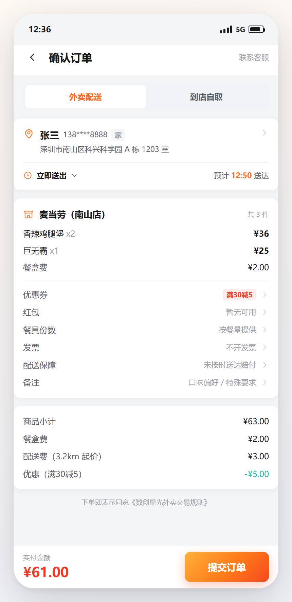

用户端 · 确认订单（外卖配送）

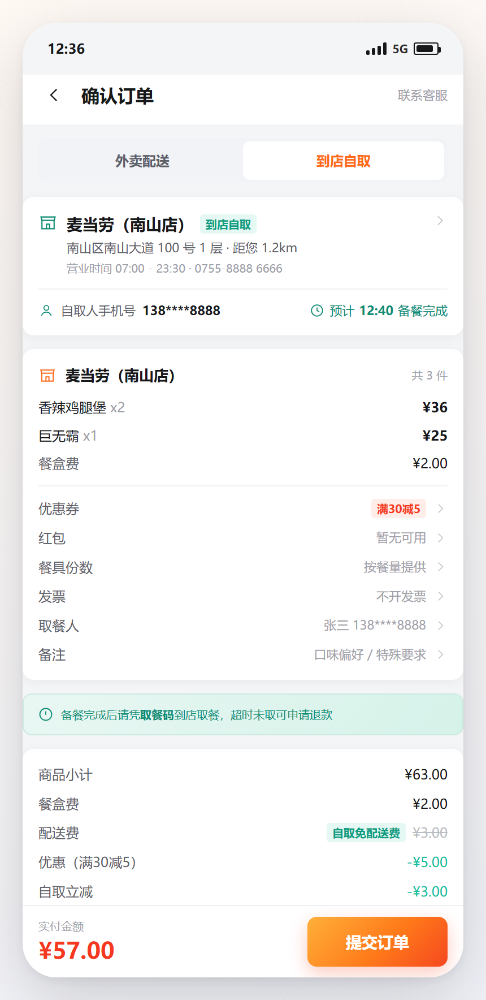

用户端 · 确认订单（到店自取）

**双履约切换**：页面顶部为「外卖配送 / 到店自取」**互斥切换**。

**外卖配送**：地址区展示收货人、手机号（脱敏）、门牌号、标签；可选「立即送出 / 预约送达」；费用明细含**配送费**（按后台 `4.5` 运费模板实时计算）与"预计送达时间"。

**到店自取**：地址区**替换为门店信息**（门店名 / 地址 / 电话 / 营业时间 / 距离）与**自取人手机号**；**免配送费**（原配送费划线展示"自取免配送费"标签）；新增**自取立减**优惠项；底部展示"预计备餐完成时间"与"凭取餐码到店取餐"提示条。

两者共用同一套优惠（券 / 红包 / 会员折扣）与金额明细结构，**金额一律由服务端最终计算一次**（见 `9.7` / `9.8`）。

**到店自取变体**：选择"到店自取"后，顶部地址区替换为门店信息（门店名 / 地址 / 电话 / 营业时间）与自取人手机号；去掉"配送费"与"预计送达时间"，改为"预计备餐完成时间"；页面底部提示"备餐完成后凭取餐码到店取餐"。

#### 5.3.4 订单详情 / 配送追踪

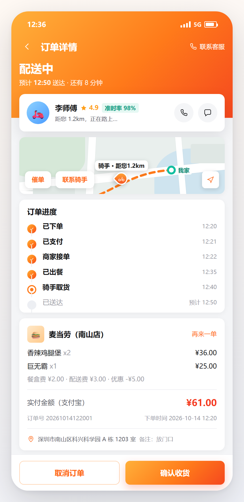

用户端 · 订单详情与配送追踪

**信息层级（配送单）**：状态卡（状态 + 预计送达 + 倒计时）→ 骑手卡（头像、姓名、评分、准时率、电话 / IM）→ 实时地图（骑手位置、路线、商家 / 我家标记、催单 / 联系骑手 / 导航）→ **订单进度时间轴**（下单 → 支付 → 接单 → 出餐 → 取货 → 送达）→ 店铺与商品明细（金额构成、实付、订单号、下单时间、收货地址与备注）→ 底部操作（取消订单 / 确认收货）。

**自取单差异**：无骑手卡与地图，"配送中"替换为"待取餐 → 已取餐"，操作区为「我已取餐 / 导航到店 /一键联系商家」，其余结构一致。

#### 5.3.5 消息中心

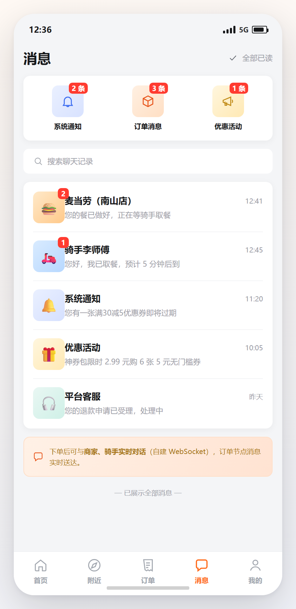

用户端 · 消息中心

**信息层级**：顶部聚合入口（系统通知 / 订单消息 / 优惠活动，含未读角标）→ 聊天记录搜索 → **会话列表**（商家 / 骑手 / 系统 / 客服，含未读数、最近消息与时间）→ 底部 Tab「消息」高亮。 **能力说明**：IM基于**自建 WebSocket**（见 `1.5` / `4.9`），支持文字、表情、图片、订单卡片、常用语与位置；App 前台实时推送、后台依赖轮询兜底 + 端上本地通知（见 `14.7 R4`）。

#### 5.3.6 我的

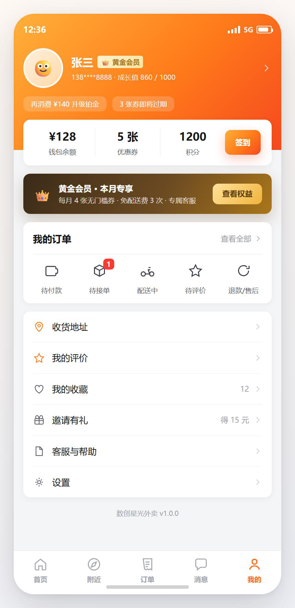

用户端 · 我的

**信息层级**：品牌渐变头部（头像、昵称、手机号脱敏、会员等级与成长值进度）→ 资产卡（钱包余额 /优惠券 / 积分 + 签到入口）→ 会员权益卡（等级、专享权益、查看权益）→ 我的订单（待付款 / 待接单/ 配送中 / 待评价 / 退款售后，含角标）→ 功能列表（收货地址、我的评价、收藏、邀请有礼、客服与帮助、设置）→ 底部 Tab「我的」高亮。

#### 5.3.7 附近（地图找店）

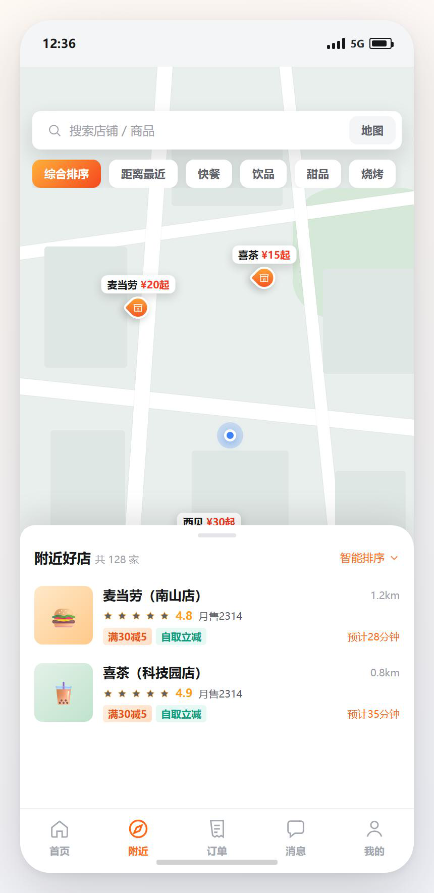

用户端 · 附近地图找店

**信息层级**：顶部搜索栏 + 筛选标签（综合排序 / 距离最近 / 品类）→ **地图图层**（当前定位蓝点、店铺气泡标记含起送价）→ 底部**上滑卡片**（附近好店列表，含评分、月售、活动标签、自取立减与预计送达）。**能力说明**：地图与定位使用**高德 / 百度开放平台个人 Key**（免费日配额，见 `1.5` / `14.7 R2`），服务端缓存地理编码结果以降低配额消耗；唤起导航使用 URL Scheme。

#### 5.3.8 取餐码（到店自取单）

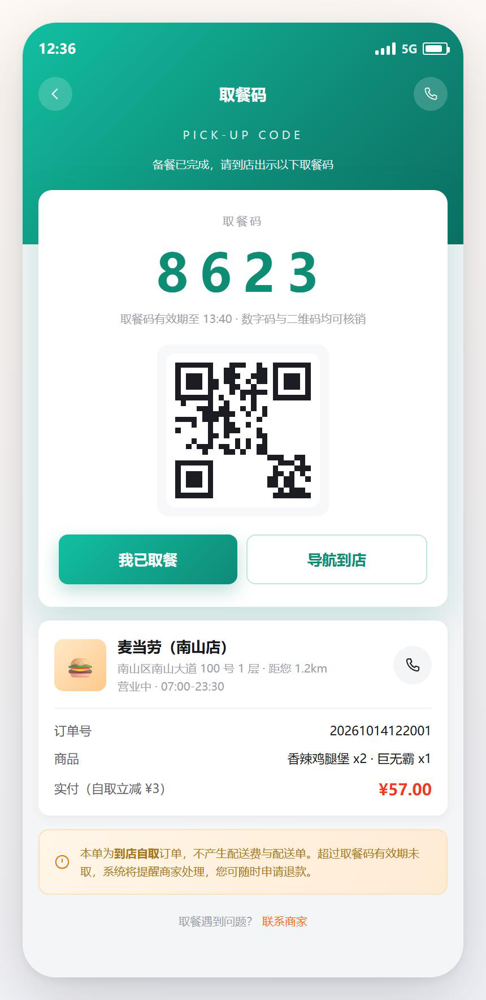

用户端 · 取餐码

**信息层级（自取链路的核心凭证）**：深青绿渐变头部 → **取餐码大字号数字 + 二维码**（同时支持"数字码输码核销"与"扫码核销"两种方式）→ 有效期提示 → 主操作「我已取餐」与「导航到店」→ 门店信息卡（门店名、地址、距离、电话、订单号、商品、实付）→ 提示条（说明自取单不产生配送费与配送单、超时未取的处理口径）。 **规则口径**：取餐码前缀 / 位数 / 有效期由后台 `4.2` 到店自取配置；**核销必须携带幂等键**防止重复核销（见 `9.6`）；商家端 App / 商家中心 Web 均可核销（见 `7.1` / `4.13`）。

#### 5.3.9 会员中心（参考美团会员体系）

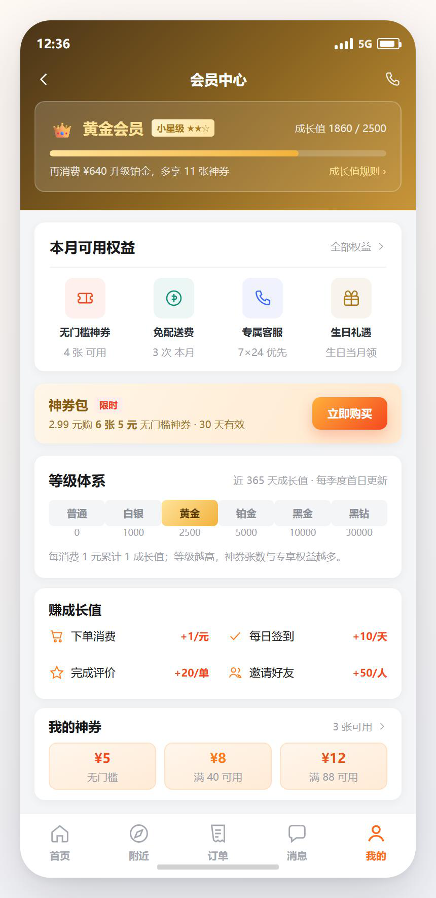

用户端 · 会员中心

**信息层级**：深金渐变头部（返回 / 标题 / 客服）→ **等级卡**（当前等级 + 小星级 + 成长值进度条 + 「再消费 ¥X 升级下一级」提示）→ **本月可用权益**四宫格（无门槛神券 / 免配送费 / 专属客服 / 生日礼遇）→ **神券包**购买卡 → **等级体系**六档横排（当前等级高亮 + 各档门槛）→ **赚成长值**任务（下单 / 签到 / 评价 / 邀请）。 **规则口径**：等级、门槛、权益项与神券包价格全部由后台 `4.6` / `4.7` 配置；成长值按近365 天累计、每季度首日更新（见 `5.2.11`）。

### 5.4 视觉与交互设计规范（统一设计令牌）

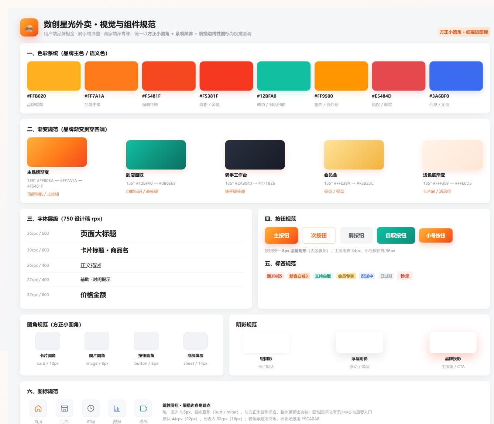

数创星光外卖 · 视觉与组件规范

**视觉基调说明**：本平台采用一套统一的**品牌橙金视觉体系**，并抽离为四端共用的**设计令牌（DesignToken）**。整体基调为 **方正小圆角 + 紧凑黑体 + 细描边线性图标**：

- **单主色橙金渐变**（`#FFB03A → #FF7A1A → #F5481F`）贯穿四端，避免"品牌色与价格色争夺焦点"；价格 / 金额统一使用 `#F5381F`。 ② 语义色闭环：成功 / 自取 `#12BFA0`、警告 `#FF9500`、错误 `#E5484D`、信

息 / 定位 `#3A6BF0`、会员金 `#FFE39A → #F2B23C`。 ③ **四端主题差异化**：用户端橙金 / 骑手端深墨 / 商家端深青绿 / 运营后台浅色 + 橙，四端**共用同一套组件与间距规范**。 ④ **方正小圆角**：圆角整体收紧到3~14px，**按钮去胶囊化**统一为 8px 圆角矩形；卡片 10px、图片 8px、标签 3px、底部弹层 14px。弱化"过度柔软"的观感，强化规整与秩序。 ⑤ **紧凑黑体**：字重收敛为**标题 600 / 正文 400**，字号整体下调一档、行高收紧至 1.4，在不拥挤的前提下提升信息密度。 ⑥ **细描边直角端点图标**：统一描边 **1.5px**，

```
端点直角（stroke-linecap: butt / stroke-linejoin: miter），与方正小圆角形成一致的硬朗气质。
```

- 所有色值、渐变、圆角、阴影、字号均以 **CSS / SCSS 变量**落地，前端仅需覆盖端主题变量即可换肤。

#### 5.4.1 色彩系统（设计令牌）

| 令牌 | 用途 | 色值 | 说明 |
| --- | --- | --- | --- |
| 品牌主色（渐变） | 顶部导航、主按钮、品牌标识、选中态 | #FFB03A → #FF7A1A → #F5481F（135°） | 贯穿四端的主渐变 |
| 品牌主橙 | 次级强调、图标着色 | #FF7A1A | 取渐变中间色 |
| 价格 / 金额 | 价格、金额、主 CTA、倒计时 | #F5381F | 全端唯一"价格红" |
| 成功 / 到店自取 | 成功、完成态、自取标识、商家端主题 | #12BFA0 | 与"自取"语义绑定 |
| 警告 / 待处理 | 待处理、超时预警 | #FF9500 | |
| 错误 / 退款 | 失败、退款、异常 | #E5484D | |
| 信息 / 定位 | 地图定位、信息提示、看板辅助色 | #3A6BF0 | 新增 |
| 会员 / 权益 | 会员等级、权益卡 | #FFE39A → #F2B23C（135°） | 暖金渐变 |
| 页面背景 | 全局背景 | #F4F5F7 | 与卡片需有明度差 |
| 卡片背景 | 内容卡片 | #FFFFFF | |
| 主 / 次 / 辅助文字 | 标题正文 / 描述 / 提示时间 | #17181A / #5C6169 / #9CA0A8 | 正文对比度 ≥ 4.5:1 |
| 分割线 | 列表与卡片内分隔 | #F0F1F4 | 优先 1px 实线，避免滥阴影 |

**四端主题色差异（同一套令牌，仅覆盖端主题变量）**

| 端 | 头部主题 | 视觉定位 |
| --- | --- | --- |
| 用户端 App / H5 | 品牌橙金渐变 | 温暖、有食欲、强营销感，活动位可高饱和 |
| 骑手端 App | 深墨蓝 #2A3040 → #171B26 + 橙色强调 | 工作台语义：弱装饰、强信息密度、关键数据大字号 |
| 商家端 App / 商家中心 Web | 深青绿 #0F8A78 → #12BFA0 | 经营语义，与"到店自取"色一致，与用户端明确区分 |
| 平台运营后台 Web | 浅色内容区 + 橙色强调 + 深色侧边栏 | 长时间使用友好、高信息密度（以表格 / 图表为主） |

#### 5.4.2 字体与字号（紧凑黑体 · 750 设计稿，单位 rpx；1rpx ≈ 0.5px @375 逻辑宽）

| 层级 | 字号 | 字重 | 行高 | 用途 |
| --- | --- | --- | --- | --- |
| 大标题 | 36rpx（≈18px） | 600 | 1.35 | 页面标题、店铺名 |
| 标题 | 30rpx（≈15px） | 600 | 1.4 | 卡片标题、商品名 |
| 正文 | 26rpx（≈13px） | 400 | 1.4 | 描述文本 |
| 辅助 | 22rpx（≈11px） | 400 | 1.4 | 时间、提示 |
| 价格 | 32rpx（≈16px） | 600 | 1.2 | 金额（数字加大，￥ 符号缩小） |
| 看板数值 | 22–26px | 700 | 1.2 | 后台 KPI（PC 端独立规范） |

**字体族**：中文 `PingFang SC`（macOS / iOS）/ `HarmonyOS Sans` / `Source Han Sans SC`，西文与数字`Segoe UI` / `Roboto`，统一以系统字体栈声明，**不引入额外字体文件**。 **数字对齐**：金额、订单号、看板数

```
值统一使用等宽数字（font-variant-numeric: tabular-nums），避免列表纵向错位。
```

#### 5.4.3 圆角、图标与组件规范

**圆角令牌（方正小圆角）**

| 元素 | 圆角 | 说明 |
| --- | --- | --- |
| 卡片 / 面板 | 10px | 由原 16px 收紧 |
| 图片 / 缩略图 | 8px | 商品图、店铺头图、地图容器 |
| 按钮 | 8px | 统一为圆角矩形，取消原 999px 胶囊 |
| 标签 / 徽标 | 3px | 活动、状态标签 |
| 底部弹层 | 14px（仅上方两角） | 由原 22px 收紧 |
| 头像 / 圆形标识 | 50% | 保持正圆 |

**图标规范（细描边 · 直角端点）**

| 项 | 规范 |
| --- | --- |
| 描边宽度 | 统一 1.5px（强调态 1.6~1.8px），不使用 2px 以上粗描边 |
| 端点与连接 | stroke-linecap: butt、stroke-linejoin: miter、stroke-miterlimit: 6（直角端点） |
| 尺寸 | 默认 44rpx（22px）；列表行内 32rpx（16px）；小徽标 18~20rpx |
| 形态 | 线性为主；仅 Tab 选中态与重要入口使用面性图标 |
| 着色 | 跟随语义色；弱化 / 次要场景统一 #9CA0A8 |

**组件规范**

| 组件 | 规范 |
| --- | --- |
| 间距 | 页面左右边距 24rpx；卡片内边距 24rpx；卡片间距20rpx；分组间距 24rpx |
| 阴影 | 轻 0 2px 10px rgba(23,24,26,.05)；浮层 0 8px 24px rgba(23,24,26,.10)；品牌投影 0 10px 26px rgba(245,72,31,.28) |
| 按钮 | 统一 8px 圆角矩形：主按钮高 44px（品牌渐变底白字）、小号按钮高 36px；次按钮白底 + 品牌描边；弱按钮浅灰底；自取按钮青绿渐变底白字 |
| 标签 | 活动标签：浅橙底 + 橙字（圆角 3px）；状态标签：浅色底 + 同色字；会员标签：暖金渐变底 |
| 图片 | 商品图统一 1:1；店铺头图 16:9；支持懒加载与渐变占位图 |
| 空状态 | 插画 + 文案 + 主按钮引导 |
| 骨架屏 | 列表首屏使用骨架屏替代 loading |
| 反馈 | 加购动效（抛物线入购物车）、支付成功动效、按钮点击 0.1s 缩放、骑手端 / 商家端新单语音播报 |

#### 5.4.4 交互规范

- **首屏加载**：定位于首屏渲染并行，首屏时间 ≤ 1.5s

- **下单路径**：首页 → 店铺 → 加购 → 结算 → 支付，全链路 ≤ 5 步；**"再来一单"可缩短至 ≤ 3 步**

- **履约方式切换**：结算页切换"配送 / 自取"须保留购物车与优惠选择，仅重算配送费与预计时间，**不重建订单**

- **配送追踪**：进入订单详情自动开启 10s 轮询 / WebSocket，页面不可见时暂停

- **自取提醒**：商家标记"备餐完成"后，用户端收到**携带取餐码**的消息与本地通知

- **消息到达**：订单状态变更实时推送；App 前台弹窗、后台本地通知、骑手端语音播报

- **异常态**：网络异常、库存不足、估清商品、地址超配送范围、自取超时未取，均需明确文案与补救入口

#### 5.4.5 设计令牌落地建议（前端）

- 抽离 `tokens.css`（色板 / 圆角 `--r-card:10px` / `--r-btn:8px` / `--r-sheet:14px` / 阴影 / 间距 / 字号 / 图标描边 `--ico-stroke:1.5`）作为**唯一来源**，四端 `import` 同一份 token；

- 端主题仅覆盖 `--brand-grad` / `--brand-head` 等少量变量即可换肤，避免各端各写一套色值；

- 后台（PC）额外维护一套表格与图表色板，与移动端共用语义色；

- 视觉交付以 `assets/ui/` 下的图片为准，标注与切图按上表输出。

## 6. 骑手端 App 需求（全新设计）

### 6.1 信息架构

```
底部 Tab：接单 │ 任务 │ 收入 │ 我的
```

### 6.2 功能明细

#### 6.2.1 账号与认证

| 功能 | 说明 | 可行性 |
| --- | --- | --- |
| 登录 | 手机号验证码登录 | 【保留】（验证码替换为模拟/邮件） |
| 实名认证 | 姓名、身份证号、证件照上传 | 【替换】 人脸/三要素需企业资质，改为后台人工审核（4.5） |
| 资质上传 | 健康证（含有效期，到期提醒） | 【保留】 |
| 审核状态 | 待审核/已通过/驳回（含驳回原因） | 【保留】 |
| 协议确认 | 骑手服务协议、隐私政策 | 【保留】 |

#### 6.2.2 接单（听单）

| 功能 | 说明 |
| --- | --- |
| 听单开关 | 上线/下线（含原因），下线后不再收单 |
| 新单播报 | 语音播报（端上 TTS）+ 弹窗倒计时（如 15s 内确认） |
| 抢单大厅 | 待抢订单列表（按距离/金额/时间排序）、一键抢单 |
| 系统派单 | 平台自动派单，强提醒确认/拒绝（含拒单原因） |
| 订单筛选 | 按距离/金额/取货距离筛选 |
| 接单上限 | 同时进行中订单上限（后台 4.5 可配） |

#### 6.2.3 任务（配送单）

| 功能 | 说明 |
| --- | --- |
| 任务列表 | Tab：待取货 / 配送中 / 已完成 / 异常 |
| 任务卡片 | 取货地址、送达地址、距离、预计送达、金额、超时倒计时 |
| 任务详情 | 商家信息（名称/电话/取货码）、用户信息（姓名/电话/地址/备注/门牌号）、商品件数 |
| 到店取货 | "我已取货"（可要求定位校验）、取货码核对 |
| 联系 | 优先 IM 聊天；电话联系使用平台回拨 / 虚拟号（隐私号通道需企业资质 → 【替换】）；如直接拨号，须对用户手机号脱敏展示并记录日志，禁止明文外泄 |
| 会话归属 | 骑手端 IM 与用户端 / 商家端共用同一后端会话通道（自建 WebSocket，见 4.9 / 9.6）：骑手在任务详情发起或回复的消息，即用户端「消息 → 会话列表」中的同一条会话，两端实时同步；会话与订单强关联（N:1），订单完成后会话保留 N 天（后台可配）后转只读留档 |
| 导航 | 内置地图导航 / 唤起高德/百度导航，多单路线规划 |
| 送达 | "已送达"（定位校验 + 拍照留证可选） |
| 异常上报 | 联系不上用户、地址错误、餐品破损、商家出餐慢、用户拒收 |
| 超时预警 | 剩余时间 < 5 分钟高亮提醒，超时记录 |
| 批量配送 | 多单单路线展示与排序建议 |

#### 6.2.4 收入与结算

| 功能 | 说明 | 可行性 |
| --- | --- | --- |
| 收入概览 | 今日/本周/本月收入、完成单量、准时率、平均单值 | 【保留】 |
| 收入明细 | 每单构成（基础配送费 + 距离补贴+ 时段补贴 + 天气补贴 + 小费 - 罚款） | 【保留】（规则来自后台 4.5） |
| 提现 | 提现申请（微信/支付宝/银行卡）、提现记录、到账状态 | 【替换】 模拟打款，仅走本地流水与状态流转 |
| 奖励 | 冲单奖、日榜奖、活动奖励 | 【保留】 |
| 罚款/扣款 | 超时、差评、违规扣款明细与申诉入口 | 【保留】 |

#### 6.2.5 我的

| 功能 | 说明 |
| --- | --- |
| 个人信息 | 头像、姓名、手机号、骑手编号、车型 |
| 我的评分 | 用户评分、评价标签、差评明细 |
| 在线时长/考勤 | 在线时长、接单时长统计 |
| 消息通知 | 系统通知、派单提醒设置 |
| 帮助与客服 | 常见问题、在线客服、规则说明 |
| 设置 | 语音播报开关、导航偏好、清除缓存、退出登录 |

### 6.3 骑手端关键页面原型图（高保真视觉稿）

本章页面均为**高保真视觉稿**。骑手端采用**深墨蓝头部 + 橙色强调**的工作台主题，弱化装饰、放大关键数据，适配骑行场景下的快速扫视需求。

#### 6.3.1 接单首页

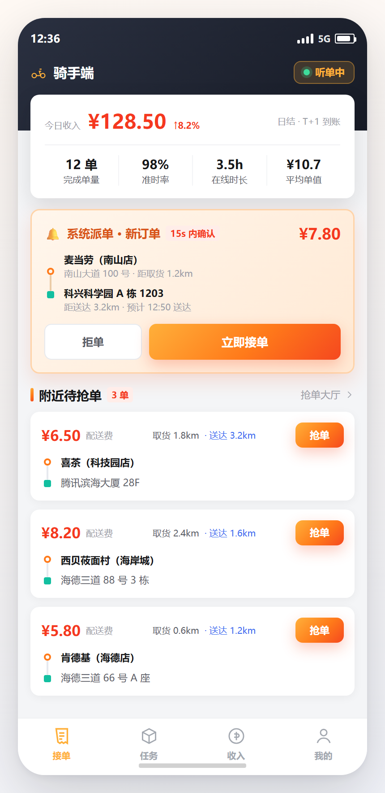

骑手端 · 接单首页

**信息层级**：头部「骑手端 + 听单中开关」→ 今日收入概览卡（今日收入、完成单量、准时率、在线时长、平均单值）→ **系统派单强提醒卡**（15s 内确认倒计时、取送地址与距离、拒单 / 立即接单）→ 附近待抢单列表（配送费、取货 / 送达距离、取送货点、一键抢单）→ 底部 Tab：接单 / 任务 / 收入 / 我的。 **规则联动**：接单上限、抢单半径、抢单优先级由后台 `4.5` 配送中心配置（见 `8.3`）。

#### 6.3.2 任务详情

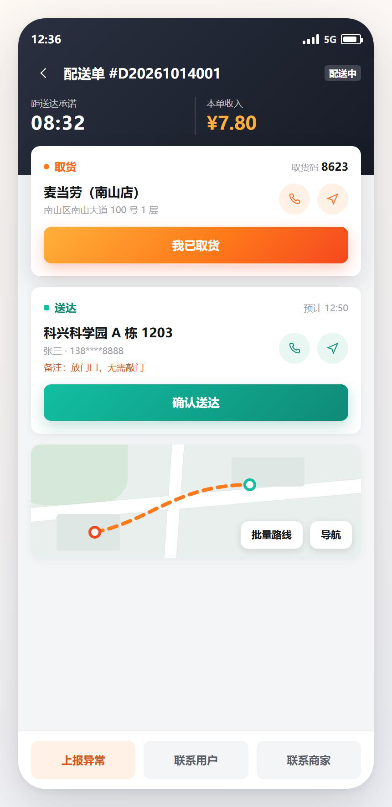

骑手端 · 配送任务详情

**信息层级**：头部配送单号 + 状态 → 承诺送达倒计时 + 本单收入 → **取货卡**（商家名、地址、取货码、电话 / 导航、「我已取货」）→ **送达卡**（收货地址、用户姓名与脱敏手机号、备注、电话 / 导航、「确认送达」）→ 地图路线（支持批量路线与导航）→ 底部操作（上报异常 / 联系用户 / 联系商家）。 **合规要点**：联系优先走 **IM**；电话联系使用平台回拨 / 虚拟号（本期【替换】），如直接拨号须**脱敏展示并记录日志**（见 `9.11`）。

#### 6.3.3 收入

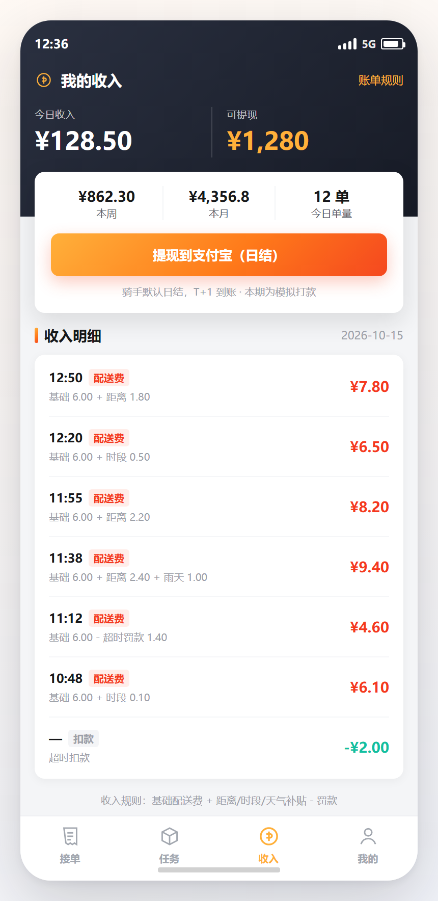

骑手端 · 收入与结算

**信息层级**：深色头部（今日收入 / 可提现）→ 结算卡（本周、本月、今日单量 + **提现到支付宝（日结）** + "日结 · T+1 到账 · 本期为模拟打款"口径说明）→ 收入明细（每单构成：基础配送费 + 距离 / 时段补贴 - 超时罚款）→ 收入规则说明。 **规则联动**：配送费与补贴规则来自后台 `4.5` 运费与计费；骑手结算周期默认**日结**（可配周结），打款为**模拟**（见 `4.8` / `8.4`）。

## 7. 商家端 App 需求（全新设计）

商家端主要用于**接单、出餐、门店经营（含到店自取核销）**；商家中心 Web 为**独立前端工程**，与商家端App 共用账号与数据，并共用同一套后端服务。

### 7.1 功能明细

| 模块 | 功能 | 可行性 |
| --- | --- | --- |
| 登录 | 账号密码/验证码登录，多门店切换 | 【保留】 |
| 首页工作台 | 今日营业额、订单量、待接单数、营业状态开关 | 【保留】 |
| 接单 | 新订单语音播报（端上 TTS）、接单/拒单（拒单原因）、自动接单开关 | 【保留】 |
| 订单管理 | 待接单/待出餐/待取货/已完成/退款Tab、订单详情、小票预览、呼叫骑手 | 【替换】 云打印 → 小票预览 + 模拟打印（生成图片/PDF 可下载） |
| 出餐管理 | 标记出餐、出餐超时提醒、备餐时长统计 | 【保留】 |
| 自取订单 | 自取订单标识与筛选、备餐完成通知用户、取餐码核销（扫码 / 手动输码）、自取超时未取处理 | 【保留】 |
| 商品管理 | 商品上下架、估清、改价（受后台审核规则约束）、库存维护 | 【保留】 |
| 门店管理 | 营业时间、营业状态、配送范围、起送价、配送费（受后台配置约束） | 【保留】 |
| 营销 | 店铺满减/优惠券创建（需平台审核）、参加平台活动 | 【保留】 |
| 财务 | 营业额、平台抽佣、结算明细、提现 | 【替换】 提现为模拟打款 |
| 评价管理 | 查看评价、回复评价、差评申诉 | 【保留】 |
| 消息 | 平台通知、系统消息（WebSocket实时） | 【保留】 |

### 7.2 商家端关键页面原型图

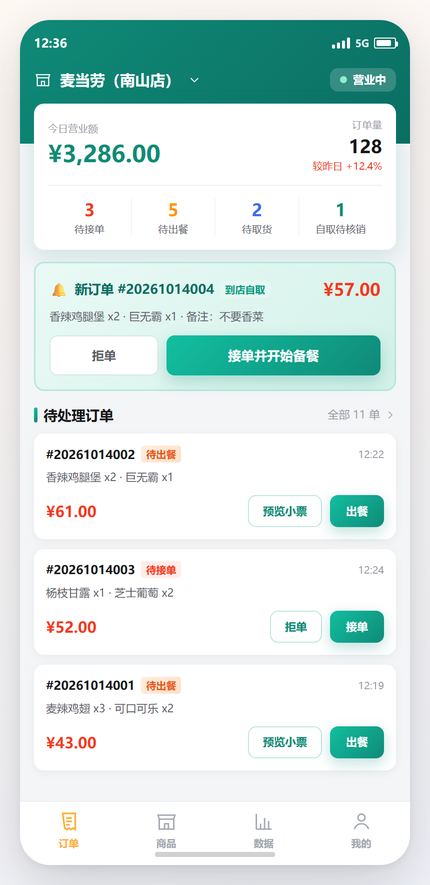

商家端 App · 经营工作台

本章页面均为**高保真视觉稿**。商家端采用**深青绿头部**主题，与用户端（橙金）、骑手端（深墨）明确区分。

**信息层级**：头部门店名 + 营业状态开关（多门店可切换）→ 经营数据卡（今日营业额、订单量、环比、待接单 / 待出餐 / 待取货 / 自取待核销）→ **新订单强提醒卡**（含"到店自取"标签、商品摘要与备注、拒单 / 接单并开始备餐）→ 待处理订单列表（订单号、状态、商品、金额、**出餐 / 预览小票 / 接单 / 拒单**）→ 底部 Tab：订单 / 商品 / 数据 / 我的。

**关联能力**：小票为**预览 + 模拟打印**（生成图片 / PDF 可下载，见 `1.5`）；自取订单的核销入口与筛选见`7.1`；门店与商品配置受平台后台约束（见 `4.2` / `4.3`）。

## 8. 关键业务流程与规则

### 8.1 外卖下单 — 配送 — 完成（主流程）

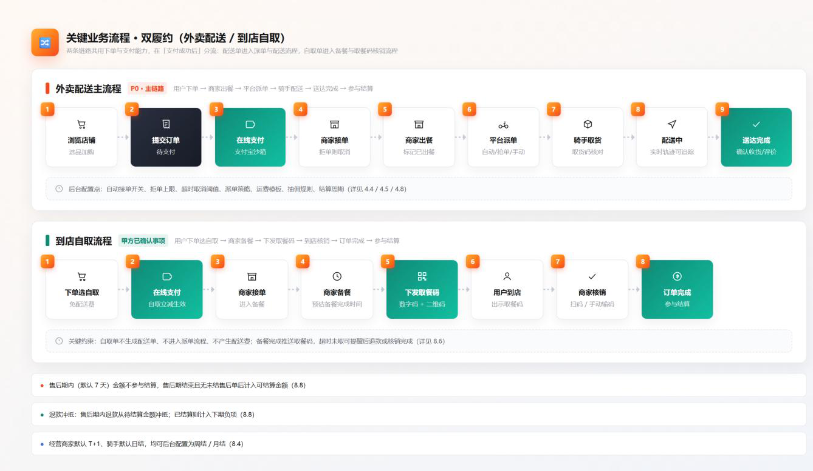

双履约关键业务流程图

**图 8-1 · 双履约关键业务流程**：横向泳道依次为「用户 → 平台系统 → 商家 → 骑手」，虚线为消息触达。两条履约链路在**支付成功后分流**：**平台配送单**进入「派单 / 抢单 → 接单 → 取货 → 配送中 → 已送达」链路；**到店自取单**由商家备餐并在完成后推送取餐码，**不进入「待取货」「配送中」状态，也不生成配送单、不计配送费**。 两类订单**共用同一套订单状态机**，自取单**不引入任何新状态**（复用「备餐中 → 待取餐→ 已取餐」）；单据全量状态与分支见 `8.9`。

**① 订单状态机 · 平台配送单**

待支付 `→` 待接单 `→` 备餐中 `→` 待取货 `→` 配送中 `→` 已送达 `→` 已完成

```
│ │ │ │
└→ 已取消 └→ 已退款 └→ 已拒单→已取消 └→ 异常（联系不上等）→ 已送达或已取消
```

**② 订单状态机 · 到店自取单**

待支付 `→` 待接单 `→` 备餐中 `→` 待取餐 `→` 已取餐 `→` 已完成

```
│ │ │ │
└→ 已取消 └→ 已退款 └→ 已拒单→已取消 └→ 超时未取 → 退款或商家核销完成（后台 4.2 可配）
```

**术语口径**：**「订单」指用户下单形成的交易单据（含平台配送单 / 到店自取单两种履约方式）；「配送单」指骑手侧履约单据，骑手接单后产生。本节的①②为订单**状态机，配送单自身状态机见 `8.9`。

**后台配置点**（对应第 4 章）：自动接单开关（4.4）、拒单上限（4.4）、超时取消阈值（4.4）、派单策略（4.5）、运费模板（4.5）、抽佣规则（4.8）、自取规则与取餐码（4.2）、结算周期（4.8）。

### 8.2 退款/售后流程

用户申请退款 `→` 系统校验（是否可退） `→` 商家审核 `→` 平台仲裁（争议时）

```
├─ 同意 → 退款到原路/余额 → 更新订单 → 通知
└─ 拒绝 → 用户可申请客服介入 → 平台仲裁（后台 4.4）
```

### 8.3 派单流程

新订单支付成功

```
├─ 到店自取单：**不进入派单流程**，由商家备餐并在完成后推送取餐码给用户
├─ 自动派单：按策略（距离最近 + 负载均衡 + 评分，后台 4.5 可配）匹配骑手
│ → 推送给骑手 → 骑手确认（超时未确认则转派）
├─ 抢单大厅：订单进入大厅 → 骑手抢单 → 先到先得 → 生成配送单
└─ 手动派单：调度员在调度中心指定骑手
```

### 8.4 结算流程

| 对象 | 周期 | 规则 | 本期实现 |
| --- | --- | --- | --- |
| 商家 | 默认 T+1（可配周结 / 月结，见 4.8） | 营业额 - 平台抽佣 - 平台承担优惠 + 商家承担优惠+ 退款冲抵（含自取订单） | 账单计算完整，打款为模拟 |
| 骑手 | 默认日结（可配周结，见4.8） | Σ(配送费 + 各类补贴 + 小费) - 罚款 | 账单计算完整，提现为模拟 |
| 提现 | 骑手/商家发起 | 审核 → 打款 → 到账通知 | 审核与状态流转完整，不做真实打款 |

### 8.5 消息触达流程

| 事件 | 触达方式 |
| --- | --- |
| 下单成功 | WebSocket 实时消息 + 站内消息 |
| 商家接单/拒单 | WebSocket 实时消息 + 站内消息 |
| 骑手接单/取货 | WebSocket 实时消息 + 订单卡片刷新 |
| 即将送达（<5 分钟） | WebSocket 消息 + 端上本地通知（强提醒） |
| 订单完成 | 消息 + 邀请评价 |
| 退款进度 | 消息 + 站内消息 |
| 骑手新单 | 骑手端语音播报 + 弹窗 + 本地通知 |
| 商家新单 | 商家端语音播报 + 弹窗 + 小票预览（模拟打印） |
| 自取备餐完成 | WebSocket 消息 + 端上本地通知（消息携带取餐码） |

### 8.6 到店自取流程

用户下单`(`选自取`) →` 支付 `→` 商家接单 `→` 备餐 `→` 标记备餐完成 `→` 推送取餐码给用户

```
│
```

用户到店 `→` 出示取餐码 `→` 商家核销`(`扫码`/`输码`) →` 已取餐 `→` 订单完成 `→` 参与结算

```
│
```

超时未取 `→` 商家`/`后台处理（提醒用户 `→` 退款或核销完成）

**关键点**：自取单**不生成配送单、不派单、不计配送费**；商家结算在扣除自取相关优惠（如自取立减）后，按 **T+1** 正常参与结算。

### 8.7 超时与准时达规则

| 规则 | 定义 |
| --- | --- |
| 承诺送达时间 | 下单时按"预计出餐时长 + 配送时长（按距离/路况估算）"计算并展示；商家接单后可微调（±N 分钟，后台可配） |
| 出餐超时 | 超过"预计出餐时长 × 阈值"仍未标记出餐 → 触发预警、推送商家、纳入商家考核 |
| 配送超时 | 超过承诺送达时间未送达 → 记录超时、纳入骑手考核（后台 4.5 奖惩规则） |
| 超时补偿 | 本期不做真实赔付，仅按后台规则发放"超时补偿券"（复用营销券链路），逻辑与正式版一致 |
| 准时率统计 | 商家准时率、骑手准时率，报表见 4.11 |

### 8.8 售后期与结算冻结规则

为解决"先结算、后退款"导致资金穿底的问题，本期明确：

| 规则 | 定义 |
| --- | --- |
| 售后期 | 订单完成（送达 / 取餐）后 N 天（默认 7 天，后台 4.4可配）内可申请售后 |
| 结算冻结 | 订单完成但处于售后期内的金额不参与结算；售后期结束且无未结售后单后，才计入可结算金额 |
| 退款冲抵 | 售后期内发生退款 → 从待结算金额中冲抵；若已结算，则计入下一期"负项"冲抵 |
| 自取单 | 售后期与配送单一致，完成时间取"已取餐"时间 |

### 8.9 状态机全集

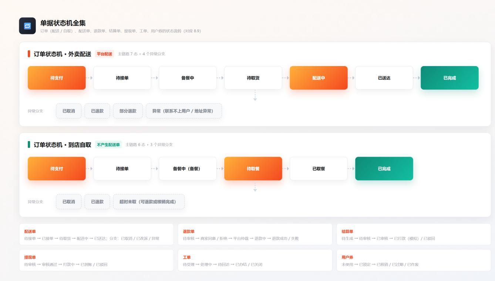

单据状态机全集

**图 8-2 · 单据状态机全集**：覆盖**订单（配送 / 自取）、配送单、退款单、结算单、提现单、工单、用户券**共 8 类单据的完整流转与分支。下表为同一内容的结构化速查表，两者口径一致，可交叉对照。

| 单据 | 状态流转 |
| --- | --- |
| 订单（配送） | 待支付 → 待接单 → 备餐中 → 待取货 → 配送中 → 已送达 → 已完成；分支：已取消 / 已退款 / 部分退款 /异常 |
| 订单（自取） | 待支付 → 待接单 → 备餐中 → 待取餐 → 已取餐 → 已完成；分支：已取消 / 已退款 / 超时未取 |
| 配送单 | 待接单 → 已接单 → 待取货 → 配送中 → 已送达；分支：已取消 / 已改派 / 异常 |
| 退款单 | 待审核 → 商家同意或商家拒绝 → 平台仲裁 → 退款中→ 退款成功 / 退款失败 |
| 结算单 | 待生成 → 待审核 → 已审核 → 已打款（模拟）/ 已驳回 |
| 提现单 | 待审核 → 审核通过 → 打款中 → 已到账 / 已驳回 |
| 工单 | 待受理 → 处理中 → 待回访 → 已办结 / 已关闭 |
| 优惠券（用户券） | 未使用 → 已锁定 → 已核销 / 已过期 / 已作废 |

## 9. 设计约定与非功能需求

### 9.1 性能

| 指标 | 要求 |
| --- | --- |
| 接口响应时间 | P95 ≤ 300ms（读），P95 ≤ 500ms（写） |
| App 首屏 | ≤ 1.5s（4G 网络） |
| 并发能力 | 设计目标：单机 1000 QPS；练手验证目标：秒杀/抢单QPS ≥ 200 且无超卖（本地压测） |
| 订单创建 | 练手验证目标：峰值 100 单/分钟（本地 Docker 压测环境） |
| 轨迹上报 | 骑手端 5~10s 一次；练手验证目标：单机模拟 200 骑手在线稳定上报 |
| 消息延迟 | 订单节点消息 ≤ 2s 到达（WebSocket 长连接）；多端界面状态一致 ≤ 3s（与第 13 章验收口径统一） |
| 后台列表 | 万级数据分页查询 ≤ 500ms |

说明：**"设计目标"为生产级参考值**，不要求练手环境达成；带"练手验证目标"的为个人环境应达成的验收值。单机 Docker 演示环境的绝对性能**不作为硬性验收项**。

### 9.2 可用性与可靠性

- **设计目标**：服务可用性 ≥ 99.9%、核心链路 ≥ 99.95%（生产级参考，练手环境不硬性验收）

- 数据库定时备份与**恢复演练**（练手环境提供备份脚本并留存一次恢复演练记录）

- 支付回调幂等、消息重试、订单状态机防并发（分布式锁）

- 关键接口限流、熔断降级

### 9.3 安全

- 全站 HTTPS，敏感字段加密存储（手机号、身份证、银行卡）

- 登录风控（验证码、异地登录提醒、账号锁定）

- **支付签名校验、回调验签、金额服务端校验**（支付宝沙箱同样需要正确验签，不可跳过）

- 越权防护（水平/垂直越权校验），接口幂等 token

- **后台越权重点**：商家只能看到自己门店数据，骑手只能看到自己的配送单

- 数据脱敏与操作审计；日志留存**练手环境 ≥ 30 天**（生产级要求 ≥ 6 个月，架构预留）

- **模拟支付/模拟短信的开关必须在生产环境强制关闭**（启动配置校验），避免"一键支付成功"误入正式环境

- 后台接口与支付宝沙箱密钥**不得提交到代码仓库**，使用环境变量/配置中心

### 9.4 兼容性

| 端 | 要求 |
| --- | --- |
| Android | 8.0 及以上，覆盖主流机型分辨率 |
| iOS | 13.0 及以上 |
| H5 | 微信内置浏览器、Safari、Chrome |
| 小程序 | 微信小程序（选做，个人主体不支持支付，仅做浏览与下单演示） |
| 后台 | Chrome / Edge 最新版，1366×768 及以上 |
| 商家中心 Web | Chrome / Edge 最新版；平板 / 移动浏览器 H5 自适应；最小 1024×768（独立前端工程，见 1.4 / 4.13） |

### 9.5 可维护性

- 前后端分离；**平台运营后台与商家中心为独立前端工程**，可分别独立构建与部署；接口文档（Swagger）自动生成

- 代码生成器支撑日常 CRUD

- 全链路日志与监控告警（接口错误率、慢 SQL、任务失败）

- 配置项集中管理；**业务规则（派单策略、运费模板、抽佣比例、订单规则）全部后台可配，不写死在代码中**

- **支付/短信/推送等外部通道全部走接口抽象**，本地可用 Mock 实现替换，便于无网络环境开发

### 9.6 接口设计约定

| 项 | 约定 |
| --- | --- |
| 协议 | HTTPS + JSON；实时通道 WebSocket |
| 鉴权 | 请求头 Authorization: Bearer <token>；后台与商家端区分 token 受众 |
| 统一响应 | { code, message, data, traceId }；code=0 成功，其余为业务错误码 |
| 分页 | pageNum / pageSize，响应含 total；默认pageSize=20，上限 100 |
| 幂等 | 写接口携带 Idempotency-Key（下单、支付、退款、核销必带） |
| 版本 | URL 前缀 /api/v1；破坏性变更升版本 |
| 时间 | 统一 UTC+8，接口使用毫秒时间戳或 ISO8601 |
| 错误码 | 按模块分段（1xxxx 系统、2xxxx 订单、3xxxx 资金…），清单见《接口文档》 |

### 9.7 金额与精度规范

- **金额一律以"分"（整数）存储与计算**，禁止浮点；展示时再转元。

- **优惠分摊**：按商品折后金额比例分摊，余数（±分）归入金额最大的商品，保证"明细合计 = 实付"。

- **舍入**：统一四舍五入到分，**且只允许服务端最终计算一次**，前端计算结果仅作展示。

- **对账**：与支付宝沙箱对账单按"交易号 + 金额"比对，**差异阈值 0**；差异进入人工处理队列并留存记录。

### 9.8 优惠叠加与分摊规则

| 项 | 规则 |
| --- | --- |
| 叠加 | 券、满减、会员价、活动价默认互斥：同单最多 1 张券+ 1 个满减；由后台活动"叠加开关"控制 |
| 优先级 | 会员价 > 活动价 > 券 > 满减（后台可调） |
| 门槛口径 | 满减/券门槛按折后商品小计判断，不含配送费与打包费 |
| 成本归属 | 平台券成本归平台、商家券成本归商家；分摊结果写入订单明细，供结算使用 |
| 保底 | 实付金额 ≥ 0.01 元（不允许 0 元或负数成交） |

### 9.9 数据字典与枚举（摘要）

| 枚举 | 取值 |
| --- | --- |
| 订单状态 | 待支付 / 待接单 / 备餐中 / 待取货 / 配送中 / 已送达 /待取餐 / 已取餐 / 已完成 / 已取消 / 已退款 / 部分退款/ 异常 |
| 履约方式 | 平台配送 / 到店自取 |
| 支付方式 | 支付宝(沙箱) / 微信(模拟) / 余额 / 组合支付 |
| 退款原因 | 商家缺货 / 出餐慢 / 配送超时 / 商品质量问题 / 用户取消 / 其他 |
| 售后责任 | 商家 / 骑手 / 平台 / 用户 |
| 提现方式 | 支付宝 / 银行卡（本期均模拟） |
| 会员等级 | 普通 / 白银 / 黄金 / 铂金 / 黑金 / 黑钻 |
| 成长值来源 | 消费 / 签到 / 评价 / 邀请 / 手工调整 |

完整枚举与码值在《接口文档》与数据库字典中维护，**前后端与文档共用同一份码值来源**。

### 9.10 埋点方案（支撑流量与转化分析）

| 事件 | 触发点 | 关键参数 |
| --- | --- | --- |
| 首页曝光 | 首页渲染完成 | 用户ID、来源、推荐位 |
| 商品/店铺点击 | 点击卡片 | 商品ID/店铺ID、位置 |
| 加购 | 点击加购 | 商品ID、规格、数量 |
| 下单 | 提交订单成功 | 订单ID、金额、履约方式 |
| 支付 | 支付成功 | 订单ID、支付方式、金额 |
| 转化漏斗 | 首页曝光 → 点击 → 加购 → 下单 →支付 | 供 4.11 流量分析使用 |

埋点写入独立表或日志文件，由报表任务聚合；练手环境可简化为"接口埋点 + 定时聚合"。

### 9.11 合规与个人信息保护

本节给出**可直接落入产品的通用隐私合规基线**。`9.11.1` 为《隐私政策》正式文本（App 首启弹窗、"设置 → 隐私与安全"内展示的是同一份内容）；`9.11.2`~`9.11.5` 为权限、个人信息、第三方 SDK 与账号注销的可执行清单；`9.11.6` 为内部工程约束。

⚠️ 本节为**通用模板**：实际上线前须由法务合规审核，并补全**运营主体全称、注册地址、联系方式、ICP备案号**与生效日期。本期为练手环境，用户数据仅存于本地 / 自建 Docker 环境、不对外提供，但仍按本基线实现，以保证日后合规上线无需返工。

#### 9.11.0 合规要点总览（开发验收清单）

| 项 | 要求 |
| --- | --- |
| 隐私政策 | App / H5 首次启动弹窗展示全文并要求确认；"我的 →设置 → 隐私与安全"可随时查阅；提供"撤回同意"入口 |
| 权限说明 | 定位 / 相机 / 相册 / 通知 / 麦克风等权限均以二次弹窗说明用途；拒绝非必要权限不影响核心流程（可降级为手动填写） |
| 个人信息清单 | 明确每一项信息的目的、字段、场景与留存期（见9.11.3） |
| 账号注销 | 提供注销入口与 7 天冷静期，注销后删除或匿名化个人信息（见 9.11.5） |
| 数据脱敏 | 客服 / 骑手 / 商家查看手机号、身份证、地址等一律脱敏（138****8888）并记录查看日志 |
| 未成年人保护 | 不面向未满 14 周岁儿童独立提供服务；未成年人须在监护人指导下使用 |
| 个性化推荐 | 提供"关闭个性化推荐"开关，关闭后仍展示不依赖个人特征的通用内容 |
| 第三方密钥 | 地图 Key、沙箱密钥、SMTP 授权码统一用环境变量管理，不入库、不入仓库 |

#### 9.11.1 《数创星光外卖隐私政策》（通用模板全文）

**生效日期**：2026-10-15 **更新日期**：2026-10-15

**引言**

数创星光外卖（以下称"我们"）深知个人信息对您的重要性。本政策适用于我们提供的全部产品与服务，包括**数创星光外卖用户端 App / H5、骑手端 App、商家端 App、商家中心 Web 以及平台运营后台**（以下统称"本服务"）。请您在使用本服务前仔细阅读并理解本政策，**特别关注以加粗形式标识的条款**。您通过勾选同意、注册账号或开始使用本服务，即表示您已阅读并同意本政策的全部内容。

**一、我们如何收集和使用您的个人信息**

1. **账号注册与登录（手机号）** 为创建账号、登录与找回密码，我们收集您的**手机号**与验证码。练手环境以"模拟验证码 + 邮件"替代真实短信通道。手机号属于必要信息，不提供将无法注册。

2. **下单与配送（收货信息、联系方式、位置）** 为完成外卖配送，我们收集**收货人姓名、手机号、收货地址**；为计算配送范围与预估送达时间，在您授权后收集**设备实时位置（经纬度）**。您也可以**手动填写地址而不授权定位**。

3. **到店自取（手机号、取餐码）** 到店自取订单**不采集收货地址与实时位置**；仅使用您的**手机号**与**取餐码**完成备餐提醒与到店核销。

4. **支付与结算（支付信息）** 支付通过第三方支付渠道完成，我们**不收集也不存储您的银行卡号与支付密码**，仅保存**支付流水号、支付状态与金额**用于订单对账。练手环境使用**支付宝沙箱**，不产生真实资金。

5. **骑手端（身份、资质、位置与留证）** 为完成骑手入驻与配送，我们收集**姓名、身份证号、证件照、健康证及有效期**；配送过程中收集**实时位置轨迹**，并在送达环节采集**送达照片 / 定位留证**。骑手位置仅在**接单至订单完成**期间采集，下线后停止。

6. **商家端与商家中心（主体资质、门店信息、经营数据）** 为完成商家入驻与结算，我们收集**营业执照、食品经营许可证、法人身份信息、门店地址与门头照、收款账户**；经营过程中收集**商品、订单、评价与结算数据**。

7. **客服与售后（沟通记录）** 为处理投诉、仲裁与退款，我们保存您在 **IM 会话、工单与客服电话**中提供的信息及沟通记录。

8. **消息通知（设备标识、通知权限）** 为推送订单状态变更、取餐提醒与营销信息，我们在您授权后收集**设备推送标识**。您可随时在系统设置或 App 内关闭；**关闭后仍可通过 App 内消息中心查看订单通知**。

9. **安全保障与故障排查（设备与日志信息）** 为识别账号异常、防范刷单与欺诈、排查崩溃，我们收集**设备型号、操作系统版本、网络类型、IP 地址、访问日志与崩溃日志**。

10. **我们不会收集的信息** 我们**不会**收集您的通讯录、短信内容、通话记录，以及未经您主动上传的相册内容与未经您主动发起的麦克风录音。

**二、我们如何申请系统权限**

所有权限均在**实际使用到该功能的场景**下申请，并在申请前以弹窗说明用途；您拒绝后我们不会再次频繁打扰，且**不影响其他功能的正常使用**。完整清单见 `9.11.2`。

**三、我们如何使用 Cookie 及同类技术**

在商家中心 Web 与平台运营后台，我们使用 Cookie / LocalStorage 保存登录凭证与界面偏好，用于保持登录状态与免重复登录。您可通过浏览器设置清除，**清除后需重新登录**。

**四、我们如何共享、转让、公开披露您的个人信息**

1. **必要共享**：为完成订单履约，向**接单骑手**提供收货人姓名、脱敏手机号与收货地址；向**商家**提供订单商品、备注与脱敏手机号。

2. **第三方服务**：我们在最小必要范围内接入地图、支付、邮件与对象存储等服务，清单见 `9.11.4`。我们要求第三方**不得将信息用于本政策未载明的目的**。

3. **转让**：我们不会转让您的个人信息，除非取得您的单独同意，或发生合并、分立等法定情形。

4. **公开披露**：仅在法律法规要求或取得您单独同意的情况下公开披露。

5. **例外**：涉及国家安全、公共安全、犯罪侦查、维护您或他人重大合法权益等法定情形，可依法不事先征得您的授权。

**五、我们如何存储与保护您的个人信息**

- **存储地点**：全部数据存储于**中国境内**服务器（练手环境为本地 Docker 容器），**不进行跨境传输**。

- **加密措施**：**身份证号、健康证、收款账户**等敏感字段加密存储；**手机号明文不入日志**；接口全程HTTPS（生产环境）。

- **访问控制**：后台角色按**最小权限**原则授权；敏感信息的查看、导出均**记录操作日志**（操作人、时间、对象）。

- **留存期**：各类信息的留存期见 `9.11.3`，到期后**删除或匿名化**处理。

**六、您的权利**

| 权利 | 实现方式 |
| --- | --- |
| 查阅与复制 | "我的 → 个人信息"查看账号资料；"我的 → 订单"查看历史订单；可申请导出副本 |
| 更正 | 在对应页面直接修改昵称、头像、地址；修改手机号需验证码 |
| 删除 | 可删除地址、评价、收货信息；账号注销时删除全部个人信息（法定留存除外） |
| 撤回授权 | "设置 → 隐私与安全 → 系统权限管理"跳转系统设置；"撤回隐私政策同意"将退出登录并清除本地缓存 |
| 关闭个性化推荐 | "设置 → 隐私与安全 → 个性化推荐"一键关闭，不影响下单与优惠领取 |
| 注销账号 | 见 9.11.5 |
| 投诉与举报 | "客服与帮助 → 投诉举报"，或通过本节第十条的联系方式反馈 |

**七、未成年人保护**

本服务主要面向成年人。**若您为未满 14 周岁的儿童，请勿注册使用本服务**；若为已满 14 周岁未满 18周岁的未成年人，请在**监护人陪同下**阅读本政策并使用本服务。我们不会主动收集儿童个人信息；如发现误收集，将及时删除。

**八、个性化推荐与广告**

首页"猜你喜欢"、优惠活动位等依据您的**历史下单、浏览与位置**进行排序。您可在"设置 → 隐私与安全"关闭个性化推荐，关闭后展示**与个人特征无关的通用内容**，不影响搜索与下单。

**九、本政策如何更新**

本政策发生**重大变更**（如新增收集字段、扩大共享范围、变更运营主体）时，我们将以**弹窗、站内信或短信**方式通知您并重新征得同意。**未经您明确同意，我们不会削减您依据本政策所应享有的权利。**

**十、如何联系我们**

- 运营主体：〔待补充：运营主体全称〕

- 联系地址：〔待补充〕

- 个人信息保护负责人邮箱：〔待补充〕

- 客服入口：App「我的 → 客服与帮助」一般情况下我们将在**15 个工作日内**答复。若您认为我们的处理行为损害了您的合法权益，可向**市场监督管理部门或网信部门**投诉举报。

#### 9.11.2 权限申请清单与触发时机

| 权限 | 使用场景 | 申请时机 | 拒绝后果 |
| --- | --- | --- | --- |
| 位置信息（精确定位） | 附近商家排序、配送范围校验、骑手导航 | 首次进入"附近"或提交订单时 | 无法自动定位，可手动输入地址继续下单 |
| 位置信息（后台定位） | 骑手配送期间轨迹上报 | 骑手点击"开始配送"后 | 不提供；改为前台定时上报（精度降低） |
| 相机 | 证件照、门头照、送达留证、评价晒图 | 点击"拍照"时 | 可改从相册选择 |
| 相册（读 / 写） | 上传证件照、评价晒图、保存取餐码 | 点击"从相册选择"时 | 无法上传图片，评价降级为文字评价 |
| 通知 | 订单状态推送、取餐提醒、新单语音播报 | 首次进入首页 / 首次接单时 | 仅 App 内消息中心可见 |
| 麦克风 | 语音消息（IM） | 长按"按住说话"时 | 无法发语音，可发文字 |
| 剪贴板 | 识别邀请码、地址分享口令 | 打开 App / 执行粘贴操作时 | 需手动输入 |
| 存储（Android 旧版本） | 保存取餐码图片、缓存商品图 | 首次保存图片时 | 无法保存图片 |
| 电话（拨号，骑手端） | 一键呼叫收 / 发货人（号码脱敏） | 点击"电话"图标时 | 可复制号码自行拨打 |

**合规要求**：① 任何权限**不得在 App 启动时一次性批量申请**；② 用户拒绝权限后**不得反复弹窗骚扰**（同一权限被拒绝 2 次后不再自动申请，仅在用户主动点击相关功能时引导至设置页）；③ 上传的证件照等敏感图片在服务端**加密存储**，仅审核角色可见并记录日志。

#### 9.11.3 个人信息收集清单与留存期

| 信息类型 | 字段 | 使用目的 | 是否必要 | 留存期 |
| --- | --- | --- | --- | --- |
| 账号信息 | 手机号、昵称、头像 | 注册登录、身份识别 | 必要 | 账号存续期间；注销后15 日内删除 |
| 配送信息 | 收货人、手机号、收货地址 | 完成配送履约 | 必要（配送单） | 订单完成起 3 年（售后与税务留存） |
| 位置信息 | 经纬度（用户端 / 骑手端） | 附近排序、配送范围、轨迹 | 非必要（可手动输入） | 用户端即用即弃；骑手轨迹 90 天 |
| 交易信息 | 订单号、金额、支付方式、流水号 | 交易记录与对账 | 必要 | 3 年 |
| 支付信息 | 第三方流水号 | 对账与退款 | 必要 | 不存卡号；流水号 3 年 |
| 实名与资质 | 姓名、身份证号、证件照、健康证 | 骑手 / 商家入驻审核 | 必要（对应角色） | 合作存续期间 + 2 年 |
| 商家主体 | 营业执照、食品经营许可证、法人信息 | 入驻审核与合规 | 必要（商家端） | 合作存续期间 + 3 年 |
| 售后与沟通 | 工单内容、IM 会话、评价 | 处理投诉与仲裁 | 非必要 | 2 年 |
| 设备与日志 | 设备型号、系统版本、IP、访问日志 | 安全风控与故障排查 | 必要 | 6 个月 |
| 营销偏好 | 埋点行为、优惠券领取记录 | 个性化推荐与营销 | 非必要 | 1 年；关闭个性化推荐后不再用于推荐 |

#### 9.11.4 第三方 SDK / 服务清单

| 第三方 | 用途 | 涉及信息 | 本项目的实现方式 |
| --- | --- | --- | --- |
| 高德 / 百度地图 | 地图展示、定位、路径规划 | 位置、设备信息 | 个人 Key，见 1.5 |
| 支付宝开放平台 | 支付、退款、对账 | 订单号、金额、交易状态 | 沙箱环境，无真实资金 |
| 邮件服务（SMTP） | 验证码、通知邮件 | 邮箱地址 | 自建 / 免费额度，替代短信 |
| 对象存储 MinIO | 证件照、门头照、商品图 | 上传的图片 | 自建，替代云 OSS |
| 推送服务 | 订单与营销推送 | 设备推送标识 | 模拟推送（App 内消息 +本地通知） |
| 短信服务 | 验证码 | 手机号 | 取消或替换为模拟验证码 /邮件，见 1.5 |
| 统计埋点 | 流量与转化分析 | 设备信息、行为埋点 | 自建埋点表 + 报表任务，见 9.10 |

第三方 SDK 均须在**隐私政策中列明名称、用途与涉及信息**，并在 App 内提供可点击查阅的详情页；新增 SDK 须同步更新本清单与隐私政策。

#### 9.11.5 账号注销流程

1. **入口**：App「我的 → 设置 → 账号与安全 → 注销账号」。

2. **前置校验**：检测是否存在**未完成订单、进行中的售后 / 退款、未结算资金、未提现余额**；若存在则提示先处理，**不允许直接注销**。

3. **冷静期**：提交注销申请后进入 **7 天冷静期**，期间账号可正常登录且可撤销申请。

4. **注销执行**：冷静期结束后账号**立即停用并退出所有登录态**；手机号与用户名释放（可重新注册）。

5. **数据处理**：个人信息**删除或匿名化**；但**交易记录、结算单、发票**等按 `9.11.3` 的留存期继续保存（依法保存，仅用于法定用途）。

6. **不可恢复**：注销后**订单历史、优惠券、积分、会员等级与成长值均不可恢复**。

7. **完成通知**：注销完成后以邮件 / 站内信形式告知。商家端与骑手端账号由平台运营后台发起"账号停用"，停用前须完成**未结算资金清算**；停用后保留资质与结算记录至留存期届满。

#### 9.11.6 内部合规与工程约束

| 项 | 要求 |
| --- | --- |
| 脱敏展示 | 手机号 138****8888、身份证 4403**********1234；后台列表默认脱敏，需二次授权方可查看完整值 |
| 脱敏日志 | 敏感信息的查看、导出、修改必须落审计日志（操作人、角色、时间、对象、IP） |
| 密钥管理 | 地图 Key、支付宝沙箱密钥、SMTP 授权码、JWT 密钥、MinIO 密钥统一以环境变量 / 密钥文件注入，不入库、不入 Git 仓库 |
| 数据导出 | 后台导出用户 / 订单数据须申请 + 审批，并记录导出范围与用途 |
| 环境隔离 | 练手环境不使用任何真实用户数据，全部为演示数据；生产环境须完成等保备案后再上线 |
| 责任人与上报 | 须指定个人信息保护负责人并在隐私政策中公示；发生数据泄露等情形须在法定时限内上报监管 |

## 10. 实施计划与里程碑

**团队版**：建议按 5 期推进，每期可独立验收。作为练习作业时，可按人/模块拆分到此粒度。

**个人练手版（MVP 路径）**：下表工期为**团队并行**参考值（合计约 35 周），单人无法按此节奏交付。个人请按 `1.6` 的 **P0 范围**推进，**12~16 周**完成可演示系统；P1 逐步补齐、P2 延后。

| 阶段 | 内容 | 交付物 | 建议工期（团队） |
| --- | --- | --- | --- |
| 一期 | 后台底座（登录、权限、租户、菜单、日志、基础设施）+ 商家招商 + 门店+ 商品中心 | 后台一期、数据库、接口 | 6 周 |
| 二期 | 用户端 App 一期（首页/附近/店铺/购物车/下单/支付/订单列表/我的）+ 后台内容运营（首页装修驱动App 首页） | 用户端 App Beta | 8 周 |
| 三期 | 订单中心 + 配送中心 + 骑手端 + 商家端（接单、出餐、派单、配送、轨迹、到店自取与取餐码核销） | 骑手端、商家端 App、后台配送模块 | 8 周 |
| 四期 | 消息中心 + 自建 IM + 评价体系 + 实时配送追踪 +客服工单 | 消息/IM/评价/客服模块 | 5 周 |
| 五期 | 营销中心（券、满减、秒杀、红包、签到、邀请、会员积分）+ 资金中心与结算 + 数据报表 | 营销、资金、报表模块 | 5 周 |
| 上线 | 联调、压测、安全自查、灰度发布、（练手可免）培训 | 上线报告、操作手册 | 3 周 |

**关键依赖与准备（个人开发者即可完成）**

| 事项 | 说明 | 获取方式 |
| --- | --- | --- |
| 支付宝沙箱应用 | APPID、应用私钥、支付宝公钥、沙箱买家账号 | 支付宝开放平台 → 沙箱环境（免费，个人可注册） |
| 地图 Key | Web 端 / Android / iOS 三套 Key | 高德或百度开放平台，个人开发者（免费配额） |
| 内网穿透 | 用于接收支付宝异步通知 | natapp / cpolar / frp（免费版可用） |
| 邮件 SMTP | 替代短信验证码 | QQ 邮箱 / 163 邮箱开启 SMTP 授权码 |
| 对象存储 | 图片视频存储 | MinIO 本地 Docker 部署 |
| 服务器 | 部署后端与前端 | 本机 Docker / 一台入门云服务器 |
| 实名资质 | 仅供人工审核演示 | 使用测试图片 |

**个人练手里程碑（参考，单人）**

| 周次 | 目标 |
| --- | --- |
| 第 1~3 周 | 脚手架 + RBAC + 商家招商 / 门店 / 商品中心 |
| 第 4~6 周 | 用户端首页 / 附近 / 店铺 / 购物车 / 下单 + 支付宝沙箱支付 |
| 第 7~10 周 | 订单中心 + 商家端接单出餐 + 骑手端接单配送 |
| 第 11~12 周 | 到店自取核销 + 结算账单（模拟打款）+ 消息（WebSocket） |
| 第 13~14 周 | 基础营销（券）+ 后台基础报表 |
| 第 15~16 周 | 联调、压测、演示脚本与文档 |

## 11. 测试方案

### 11.1 测试层级

| 层级 | 范围 | 工具 / 方式 | 练手要求 |
| --- | --- | --- | --- |
| 单元测试 | 核心领域逻辑（金额计算、优惠分摊、状态机、派单策略） | JUnit 5 + Mockito | 核心类覆盖率 ≥ 60% |
| 接口测试 | 主要 REST 接口 | Postman / Apifox 集合 | P0 接口用例齐全 |
| 集成测试 | 下单 → 支付 → 派单 → 送达 → 结算主链路 | 自研脚本 / 测试环境 | 至少 1 条端到端脚本 |
| 性能测试 | 秒杀 / 抢单 / 下单 | JMeter / wrk | 达成 9.1 练手验证目标 |
| 安全自查 | 越权、支付验签、幂等 | 手工 + 简单脚本 | 三类问题零缺陷（见第 13章） |
| 兼容性 | 终端矩阵（9.4） | 真机 / 模拟器 | 覆盖主流机型 |
| 验收测试（UAT） | 按第 13 章用例 | 人工 | 甲方 / 评审人执行 |

### 11.2 关键测试用例（摘要）

| 场景 | 用例要点 |
| --- | --- |
| 支付 | 沙箱支付成功 / 失败 / 超时；回调重复（幂等）；金额篡改被拒 |
| 下单 | 库存不足、估清商品、超配送范围、自取单免配送费 |
| 优惠 | 券与满减互斥、分摊合计等于实付、门槛按折后小计 |
| 派单 | 自动派单 / 抢单 / 手动改派、超时未接转派、无骑手兜底 |
| 自取 | 取餐码生成 / 核销 / 重复核销拦截、超时未取处理 |
| 售后 | 商家同意 / 拒绝、平台仲裁、退款原路或余额、结算冲抵 |
| 结算 | 售后期冻结、T+1 出账、退款冲抵、对账差异 |
| 权限 | 商家 / 骑手 / 客服 / 财务越权拦截、数据脱敏 |
| 消息 | WebSocket 断线重连、离线消息补推、消息不丢不重 |

### 11.3 缺陷分级与准出

| 等级 | 定义 | 准出要求 |
| --- | --- | --- |
| P0 | 阻断主链路（下单 / 支付 / 派单 / 结算不可用） | 必须清零 |
| P1 | 影响主功能但有绕过方案 | 建议清零；遗留需说明 |
| P2 | 体验 / 文案 / 次要功能问题 | 允许遗留，登记在册 |

## 12. 上线与运维方案

### 12.1 环境划分

| 环境 | 用途 | 说明 |
| --- | --- | --- |
| dev | 开发自测 | 本机 Docker Compose 一键启动 |
| test | 联调测试 | 单机部署后端 + 前端，使用沙箱 /模拟通道 |
| prod | 生产 / 演示 | 可选：一台入门云服务器；练手可只到 test |

### 12.2 部署与发布

- 后端：Docker 镜像 + Compose（或 jar + systemd）；前端：Nginx 静态托管，**后台与商家中心分别部署**。

- 配置：环境变量 / 配置中心；**密钥不入仓库**。

- 发布：蓝绿或滚动；练手可"停机发布 + 快速回滚"。

- 数据库变更：脚本化迁移（Flyway / Liquibase 或编号 SQL），**可回滚**。

### 12.3 上线 checklist

| 项 | 内容 |
| --- | --- |
| 数据 | 初始化字典、地区、平台账号、演示商家 / 门店 / 商品 |
| 配置 | 支付渠道、地图 Key、运费模板、派单策略、抽佣、售后期、自取规则 |
| 开关 | 模拟支付 / 模拟短信开关状态正确（生产必须关闭模拟） |
| 回调 | 支付宝异步通知地址可达（内网穿透 / 公网域名） |
| 监控 | 接口错误率、慢 SQL、任务失败、WebSocket 连接数告警 |
| 备份 | 数据库备份任务已开启 |

### 12.4 回滚与应急

- 回滚：保留上一版本镜像 / 包，**5 分钟内可回滚**；数据库变更提供反向脚本。

- 应急：支付回调积压 → 重试补偿；消息堆积 → 扩容消费者；派单异常 → 切换手动派单。

### 12.5 运维

- 日志：集中收集（文件 / ELK 可选），留存见 `9.3`。

- 监控告警：接口错误率、慢 SQL、定时任务失败、磁盘 / 内存。

- 容量：按"单机 + 200 骑手模拟 + 100 单/分钟"规划；扩容优先加应用节点。

- 备份：每日全量 + 增量，**每季度恢复演练**（练手至少 1 次）。说明：练手项目可将 `prod` 简化为"内网演示环境"，但**环境划分、配置外置、可回滚**三项原则不打折。

## 13. 验收标准

| 类别 | 验收标准 |
| --- | --- |
| 功能完整性 | P0 功能全部实现并通过用例（通过率 100%）；P1 建议通过；P2 允许延后（范围见 1.6） |
| 后台与 App 对应性 | 后台每一个可配置项（首页装修、品类、运费模板、派单策略、抽佣、订单规则、营销活动）都必须真实驱动App / 骑手端 / 商家端的效果，不允许只做界面不生效 |
| 流程闭环 | 用户下单 → 商家接单出餐 → 骑手配送 → 用户收货评价全链路可跑通（支付需真实走通支付宝沙箱） |
| 双履约闭环 | 到店自取链路可跑通：自取下单 → 商家备餐 → 取餐码下发 → 到店核销 → 订单完成；自取单不产生配送单与配送费 |
| 独立工程 | 平台运营后台与商家中心为两个独立前端工程，可分别独立构建、部署与访问，共用同一后端服务与权限模型 |
| 多端一致性 | 用户端/骑手端/商家端/后台状态实时一致，延迟 ≤ 3s |
| 权限隔离 | 商家、骑手、客服、财务的数据可见范围正确，越权用例全部拦截 |
| 个人可落地 | 全流程不需要任何企业资质、付费账号或专用硬件即可完整演示 |
| 性能 | 达成 9.1 练手验证目标并产出压测记录（单机绝对性能不作硬性要求） |
| 安全 | 安全自查 + 代码审计；支付验签、越权、并发扣库存三类问题零缺陷 |
| 兼容性 | 覆盖 9.4 终端矩阵中的主流机型 |
| 文档 | 交付需求文档、设计文档、接口文档、部署文档、操作手册、测试报告 |
| 培训 | （团队版）完成运营、客服、财务、商家、骑手五类培训；（练手版）提供演示脚本与操作说明 |

## 14. 附录

### 14.1 页面清单（用户端）

| 分组 | 页面 |
| --- | --- |
| 启动 | 启动页、引导页、登录/注册、隐私协议 |
| 首页 | 首页、搜索、搜索结果、附近（地图找店） |
| 店铺 | 店铺详情、商品详情/规格选择、店铺评价、店铺信息 |
| 交易 | 购物车、确认订单（配送 / 自取切换）、选择地址/新增地址/地图选点、优惠券选择、支付、支付结果 |
| 订单 | 订单列表、订单详情、配送追踪、取餐码、退款申请、退款详情 |
| 消息 | 消息中心、系统通知、订单消息、会话列表、聊天窗口 |
| 评价 | 评价填写、评价详情 |
| 我的 | 个人资料、钱包、充值、余额明细、优惠券、积分、积分商城、会员中心、地址管理、我的评价、收藏、客服、帮助、反馈、设置、邀请有礼、签到 |

### 14.2 页面清单（骑手端）

说明：**到店自取订单不进入骑手端**（不派单、不生成配送单），骑手端仅处理外卖配送单。

| 分组 | 页面 |
| --- | --- |
| 登录认证 | 登录、实名信息填写与证件上传、审核结果 |
| 接单 | 接单首页、抢单大厅、新单弹窗 |
| 任务 | 任务列表、任务详情、导航、取货确认、送达确认、异常上报 |
| 收入 | 收入概览、收入明细、提现、提现记录、奖励、扣款明细 |
| 我的 | 个人资料、我的评分、在线时长、消息、帮助、设置 |

### 14.3 页面清单（商家端 / 商家中心）

登录、工作台、接单、订单列表、订单详情、出餐、**小票预览**、**自取订单与取餐码核销**、商品管理、门店设置、营销、财务、评价、消息、我的

### 14.4 页面清单（平台运营后台）核心页面

说明：商家中心 Web 为**独立前端工程**，其页面与商家端 App 共用菜单与数据，导航见 `4.13`，页面清单见 14.3。

| 分组 | 核心页面 |
| --- | --- |
| 工作台 | 数据看板、待办中心、预警中心 |
| 商家招商 | 入驻申请列表/审核、商家列表/详情、门店列表/编辑（含地图选点与围栏绘制）、到店自取配置（自取开关/ 取餐码规则）、门店装修、商家结算账户 |
| 商品中心 | 平台品类、商品库、门店商品审核、规格/加料模板、估清管理、评价管理、素材库 |
| 订单中心 | 订单列表、订单详情、售后仲裁、异常订单池、订单规则配置 |
| 配送中心 | 骑手认证审核、骑手档案、骑手排班、调度中心（实时地图）、配送单与轨迹回放、运费模板、配送范围 |
| 营销中心 | 优惠券、满减、折扣、秒杀、红包、签到、邀请、会员权益、积分商城、充值、营销分析 |
| 用户中心 | 用户列表/详情、标签分群、会员等级、地址、钱包余额、反馈 |
| 资金中心 | 支付渠道配置、支付流水、退款流水、对账、佣金规则、商家结算、骑手结算、提现审核 |
| 内容运营 | 首页装修、广告位、搜索运营、消息模板、公告、App版本 |
| 客服工单 | 客服工作台、工单、投诉处理、FAQ、客服绩效 |
| 数据报表 | 经营总览、流量分析、商品/商家/骑手分析、营销分析、财务报表 |
| 系统管理 | 用户、角色、菜单、部门岗位、字典地区、租户套餐、OAuth2、日志、基础设施 |

### 14.5 术语表

| 术语 | 含义 |
| --- | --- |
| SKU | 商品最小库存单位（如"大杯/少冰/半糖"的组合） |
| 估清 | 商品临时售罄，不参与售卖 |
| 围栏 | 门店可配送的地理范围（圆形/多边形） |
| 派单 | 平台把订单分配给骑手的行为 |
| 抢单 | 骑手主动领取订单 |
| 抽佣 | 平台从商家营业额中抽取的佣金 |
| 沙箱环境 | 官方提供的、与生产隔离的测试环境（如支付宝沙箱） |
| Mock / 模拟通道 | 用本地实现替代需企业资质的外部接口，接口形态与真实通道一致 |
| 骨架屏 | 数据加载时的占位页面结构 |
| 到店自取 | 用户在用户端下单后到门店自提的履约方式，不产生配送单与配送费 |
| 取餐码 | 自取订单的核销凭证（数字码 + 二维码），商家扫码或输码完成核销 |
| 独立前端工程 | 拥有独立仓库、独立构建、独立部署与访问域名的前端项目，可复用同一后端服务 |
| 成长值 | 会员等级的判定依据，按近 365 天累计，只增不减（与可消耗的积分区分） |
| 神券 | 会员核心权益凭证，分「有门槛免费神券」与「付费无门槛神券包」两类 |

### 14.6 甲方确认记录

**已确认**

| 序号 | 事项 | 确认结论 |
| --- | --- | --- |
| 1 | 商家端与平台后台的工程形态 | 拆分为两个独立前端工程（独立仓库/ 部署 / 域名），后端复用同一套服务与权限模型 |
| 2 | 是否支持到店自取 | 支持，覆盖用户端下单、商家备餐、取餐码核销全流程；自取单不进入配送 |
| 3 | 结算周期 | 商家默认 T+1、骑手默认日结（后台可配为周结 / 月结） |
| 4 | 微信小程序 | 非必做，作为选做项（个人主体不支持支付） |
| 5 | 平台品牌名称 | 「数创星光外卖」 |
| 6 | 会员体系形态 | 参考美团的等级会员制（成长值 +六档等级 + 神券权益），不做订阅制付费会员卡（见 5.2.11） |
| 7 | 抽佣规则 | 参考美团费率结构：技术服务费（佣金）按品类 3%~15%（餐饮5.5%~8.5%）+ 履约服务费按距离 /时段阶梯计价（见 4.8） |

**待确认**

| 序号 | 事项 | 说明 |
| --- | --- | --- |
| 1 | 练习作业的考核范围与评分标准（建议：后台业务域 30% + 用户端 25% + 骑手/商家端 20% + 支付与消息15% + 文档与规范 10%） | 影响作业命题 |
| 2 | 是否统一技术栈与脚手架（避免各人实现差异过大） | 影响协作与评审 |

说明：**多城市 / 多区域运营**已在 `1.4` 明确"本期不包含（架构预留）"，故不再列为待确认项；**商家中心独立菜单体系**已在 `4.13` 按独立工程确定。

### 14.7 风险登记册

| 编号 | 风险 | 影响 | 概率 | 应对措施 |
| --- | --- | --- | --- | --- |
| R1 | 支付宝沙箱政策调整 /个人注册受限 | 支付链路无法演示 | 中 | 保留统一PaymentChannel 抽象，可切换余额 / 模拟通道兜底 |
| R2 | 地图个人 Key 日配额耗尽 | 定位 / 围栏 / 轨迹异常 | 中 | 服务端缓存地理结果、限流，降级为"静态地址+ 直线距离" |
| R3 | 内网穿透不稳定 | 支付回调丢失 | 中 | 多通道（cpolar + frp）+ 回调主动轮询补偿 |
| R4 | 自建 WebSocket 在App 被系统回收后收不到推送 | 用户 / 骑手漏消息 | 高 | 列为已知限制：前台实时、后台依赖轮询兜底+ 端上本地通知 |
| R5 | 单机 Docker 性能不足 | 压测不达标 | 高 | 采用 9.1 练手验证目标，必要时降低并发模拟量 |
| R6 | 工期不足（单人 35 周不可行） | 无法交付 | 高 | 严格执行 1.6 MVP（P0）范围，P1/P2 延后 |
| R7 | 模拟通道误用于生产 | 资金 / 安全风险 | 低 | 启动配置校验，生产强制关闭模拟开关（见9.3） |
| R8 | 个人开发者上架 App市场受限 | 分发受限 | 中 | 以 H5 + 内测安装包为主要演示渠道；正式上架需软著等资质 |
| R9 | 优惠叠加规则实现错误 | 资金计算错误 | 中 | 统一规则引擎 + 分摊校验（见 9.7 / 9.8）+ 用例覆盖 |

### 14.8 个人开发环境清单（练习者参考）

| 类别 | 推荐方案 | 是否收费 |
| --- | --- | --- |
| JDK | JDK 17 | 免费 |
| 数据库 | MySQL 8（Docker） | 免费 |
| 缓存 | Redis 6+（Docker） | 免费 |
| 消息队列 | RabbitMQ / RocketMQ（Docker） | 免费 |
| 对象存储 | MinIO（Docker） | 免费 |
| 地图 | 高德 / 百度开放平台个人 Key | 免费（有额度） |
| 支付 | 支付宝开放平台沙箱 | 免费 |
| 内网穿透 | natapp / cpolar / frp | 免费版可用 |
| 邮件 | QQ / 163 邮箱 SMTP 授权码 | 免费 |
| 代码托管 | Gitee / GitHub 私有仓库 | 免费 |
| 前端 | Vue 3 + Vite + Element Plus / UniApp | 免费 |
| 容器 | Docker Desktop | 免费（个人使用） |

**文档结束**

本需求文档为**全新设计**：第 4 章平台运营后台按本项目"平台级外卖平台（多商家 + 骑手配送 + 美团式用户端）"的业务模型重新组织，与第 5~7 章的用户端 / 骑手端 / 商家端功能一一对应；参考系统`yshop-drink` 仅作为技术栈与实现经验的参考。全文按"个人开发者可落地"原则完成功能取舍（见 `1.5`），确保全部【保留】【替换】功能在不具备企业资质的前提下可以完整实现与演示。

**本版核心设定**：① 品牌为 **「数创星光外卖」**；② 平台运营后台与商家中心为**独立前端工程**；③ 支持**到店自取**（含取餐码核销），自取单不进入配送流程；④ 结算周期为**商家 T+1 / 骑手日结**（后台可配）；

- 微信小程序**非必做**；⑥ 会员体系**参考美团等级会员制**（成长值 + 六档等级 + 神券权益）；⑦ 抽佣**参考美团费率结构**（技术服务费 + 履约服务费）；⑧ 骑手由**平台统一调度**，组织扁平、无中间管理角色。请甲方对 `14.6` 待确认事项确认后，进入**详细设计**阶段。
